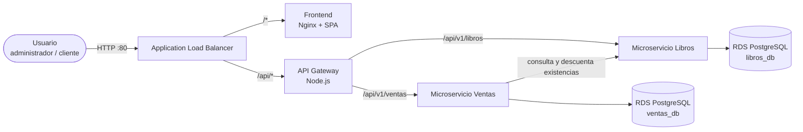

# Librería AYD

Plataforma web para la gestión y consulta del catálogo de una librería. Permite ver los libros
disponibles (título, autor, precio y existencias), buscarlos y filtrarlos por nombre o autor, y
consultar el ranking de los títulos más vendidos, calculado a partir de las ventas registradas.

El sistema usa el **patrón de microservicios sobre una arquitectura por capas**, con una
**API Gateway** como único punto de entrada. Se despliega en **AWS** con **Terraform**
(infraestructura como código) y **Ansible** (configuración y despliegue), y todos los
componentes corren en contenedores **Docker**.

> Universidad de San Carlos de Guatemala · Facultad de Ingeniería · Escuela de Ciencias y Sistemas
> Análisis y Diseño de Sistemas 2 · Sección B · Segundo semestre 2026 · Práctica 2

---

## Equipo — Grupo 4

| Integrante | Carnet | Rol | Componente principal |
|------------|--------|-----|----------------------|
| Carlos Javier Pérez Pocón | 202206425 | Arquitecto de software y coordinador | Arquitectura, contratos de API, API Gateway, integración y releases |
| Luis Fernando González | 202307727 | Desarrollador backend | Microservicio de Libros |
| Eduardo Misael López Ávila | 202100147 | Desarrollador backend | Microservicio de Ventas y ranking |
| Kevin Mark Hernández Chicol | 202001053 | Desarrollador frontend | Aplicación web y manual de usuario |
| Billy James Asael Chamale Sánchez | 201907502 | Ingeniero DevOps / Cloud | Terraform, Ansible, ECR y despliegue en AWS |

El reparto detallado de tareas está en [`docs/equipo/plan-de-trabajo.md`](docs/equipo/plan-de-trabajo.md).

---

## Arquitectura



| Componente | Tecnología | Puerto | Carpeta |
|------------|-----------|--------|---------|
| Frontend | React + Vite, servido por Nginx | 80 | [`frontend/`](frontend/) |
| API Gateway | Node.js 22 + Express | 8080 | [`api-gateway/`](api-gateway/) |
| Microservicio Libros | Node.js 22 + Express | 3001 | [`services/libros/`](services/libros/) |
| Microservicio Ventas | Node.js 22 + Express | 3002 | [`services/ventas/`](services/ventas/) |
| Persistencia | PostgreSQL 16 (Amazon RDS) | 5432 | — |
| Infraestructura | Terraform + Ansible | — | [`infra/`](infra/) |

## Documentación

| Documento | Descripción |
|-----------|-------------|
| [Requerimientos y drivers](docs/arquitectura/01-requerimientos.md) | Actores, casos de uso, drivers funcionales, de calidad y de restricción |
| [Arquitectura lógica](docs/arquitectura/02-arquitectura.md) | Patrón, capas, componentes y decisiones de diseño |
| [Arquitectura de despliegue](docs/arquitectura/03-despliegue.md) | Diagrama UML de despliegue y papel de Terraform y Ansible |
| [Contratos de API](docs/arquitectura/04-contratos-api.md) | Endpoints, modelos y errores (OpenAPI en [`docs/api/`](docs/api/)) |
| [Decisiones de arquitectura](docs/arquitectura/adr/) | Registro de decisiones (ADR) |
| [Manual de usuario](docs/manuales/manual-usuario.md) | Uso de la plataforma web |
| [Guía de contribución](CONTRIBUTING.md) | Ramas, commits y pull requests |

## Ejecución local

Requisitos: Docker 24+ y Docker Compose v2.

```bash
cp .env.example .env
docker compose up --build
```

| URL | Servicio |
|-----|----------|
| http://localhost:8081 | Frontend |
| http://localhost:8080/health | API Gateway |
| http://localhost:8080/health/servicios | Estado agregado de los microservicios |

Los puertos publicados se cambian con `GATEWAY_PORT` y `FRONTEND_PORT` en `.env`, por si ya
están ocupados en el equipo.

Para levantar un componente aislado mientras los demás siguen en desarrollo:

```bash
docker compose up --build --no-deps api-gateway
```

### Variables que consume cada microservicio

`docker-compose.yml` es también el contrato de configuración entre componentes:

| Servicio | Variables |
|----------|-----------|
| `libros` | `PORT`, `DB_HOST`, `DB_PORT`, `DB_NAME`, `DB_USER`, `DB_PASSWORD`, `DB_SSL`, `LOG_LEVEL` |
| `ventas` | Las mismas de base de datos, más `LIBROS_SERVICE_URL` |
| `api-gateway` | Ver [`api-gateway/README.md`](api-gateway/README.md#variables-de-entorno) |
| `frontend` | Usa rutas relativas `/api/v1/...`; Nginx reenvía `/api/` a `api-gateway:8080` en local y el ALB lo hace en AWS |

## Flujo de trabajo

- `main`: releases estables etiquetados (`vX.Y.Z`).
- `develop`: integración continua del trabajo del equipo.
- Ramas de trabajo: `<tipo>/<descripcion>_<carnet>`, por ejemplo `feature/api-gateway_202206425`.

Más detalle en [CONTRIBUTING.md](CONTRIBUTING.md).
