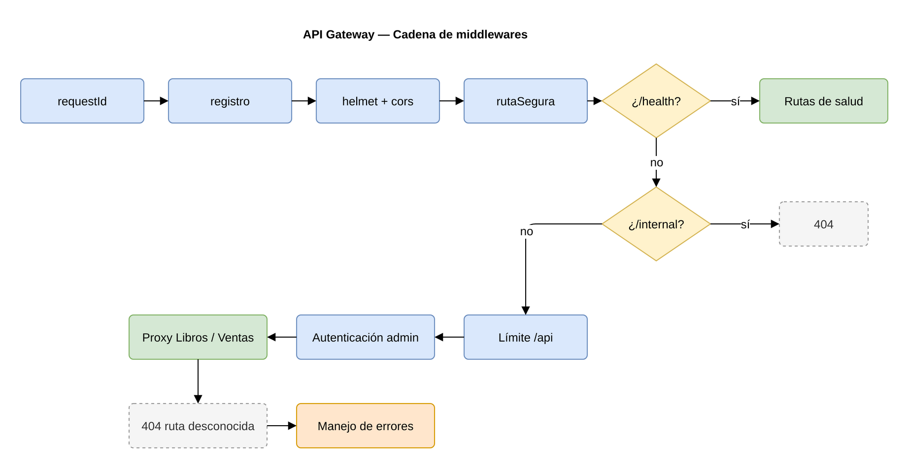

# API Gateway

Responsable: **Carlos Javier Pérez Pocón** (202206425)

Único punto de entrada de la Librería AYD. Recibe todas las peticiones del frontend (a
través del ALB) y las reenvía al microservicio dueño del recurso.

## Responsabilidades

| Responsabilidad | Implementación |
|-----------------|----------------|
| Enrutamiento | [`src/app.js`](src/app.js) — tabla de rutas por prefijo; proxy en *streaming* en [`src/proxy/proxyServicio.js`](src/proxy/proxyServicio.js) |
| Autenticación de administrador | [`src/middlewares/autenticacionAdmin.js`](src/middlewares/autenticacionAdmin.js) — `X-Api-Key`, comparación en tiempo constante |
| Bloqueo de rutas internas | `/internal/*` responde `404`; [`rutaSegura.js`](src/middlewares/rutaSegura.js) rechaza `..`, `//` y rutas codificadas |
| Límite de peticiones | [`limitePeticiones.js`](src/middlewares/limitePeticiones.js) — por IP, solo en `/api` |
| Trazabilidad | [`requestId.js`](src/middlewares/requestId.js) y [`registroPeticiones.js`](src/middlewares/registroPeticiones.js) — `X-Request-Id` y logs JSON |
| Errores uniformes | [`manejoErrores.js`](src/middlewares/manejoErrores.js) y [`utils/errores.js`](src/utils/errores.js) |
| Salud | `GET /health` (proceso) y `GET /health/servicios` (estado de cada microservicio) |

## Cadena de middlewares



## Rutas

| Prefijo | Destino | Variable |
|---------|---------|----------|
| `/api/v1/libros` | Microservicio de Libros | `LIBROS_SERVICE_URL` |
| `/api/v1/ventas` | Microservicio de Ventas | `VENTAS_SERVICE_URL` |

Las rutas se reenvían **sin reescribir**, así que el contrato del gateway es el mismo que el
de cada servicio. La política de acceso completa está en
[`docs/arquitectura/04-contratos-api.md`](../docs/arquitectura/04-contratos-api.md#2-rutas-expuestas-por-la-api-gateway).

## Traducción de fallos

| Situación | Respuesta |
|-----------|-----------|
| El servicio rechaza la conexión o no se resuelve su DNS | `503 SERVICIO_NO_DISPONIBLE` |
| El servicio no responde dentro de `PROXY_TIMEOUT_MS` | `504 TIEMPO_AGOTADO` |
| La conexión se corta a mitad de la respuesta | `502 RESPUESTA_INVALIDA` |

## Variables de entorno

| Variable | Por defecto | Descripción |
|----------|-------------|-------------|
| `PORT` | `8080` | Puerto de escucha |
| `ADMIN_API_KEY` | — (obligatoria) | Llave de administración, mínimo 16 caracteres |
| `LIBROS_SERVICE_URL` | `http://localhost:3001` | URL del servicio de Libros |
| `VENTAS_SERVICE_URL` | `http://localhost:3002` | URL del servicio de Ventas |
| `PROXY_TIMEOUT_MS` | `10000` | Tiempo límite hacia los servicios |
| `HEALTH_TIMEOUT_MS` | `2000` | Tiempo límite de cada consulta de salud |
| `RATE_LIMIT_WINDOW_MS` | `60000` | Ventana del límite de peticiones |
| `RATE_LIMIT_MAX` | `300` | Peticiones por IP en la ventana |
| `TRUST_PROXY_HOPS` | `1` | Proxies confiables delante del gateway (el ALB) |
| `CORS_ORIGINS` | vacío (todos) | Orígenes permitidos, separados por coma |
| `LOG_LEVEL` | `info` en producción, `debug` en otro caso | `debug`, `info`, `warn`, `error` |
| `APP_VERSION` | `0.1.0` | Versión reportada en `/health` |

## Desarrollo

```bash
cd api-gateway
cp .env.example .env
npm install
npm run dev
```

## Pruebas

```bash
npm test
npm run test:coverage
```

Las pruebas levantan microservicios simulados en puertos aleatorios, así que no necesitan
Docker ni bases de datos.

## Imagen Docker

```bash
docker build -t libreria-ayd/api-gateway:0.1.0 .
docker run --rm -p 8080:8080 -e ADMIN_API_KEY=una-llave-de-16-caracteres libreria-ayd/api-gateway:0.1.0
```
