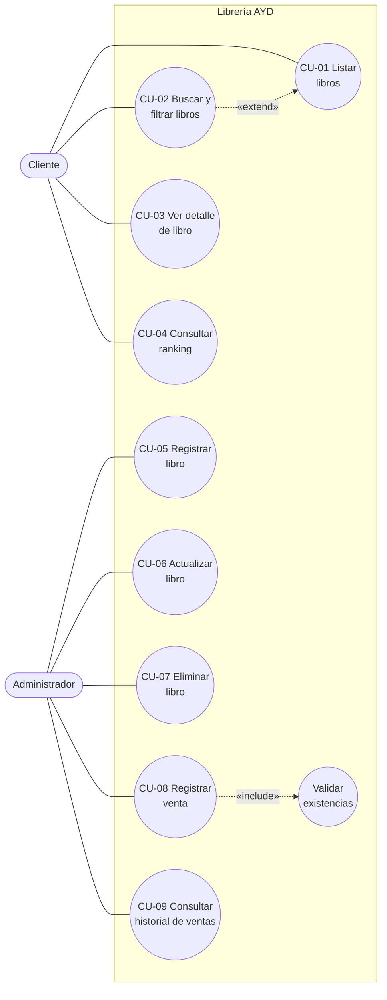

# 01 · Requerimientos y drivers de arquitectura

## 1. Contexto del negocio

La Librería AYD necesita una plataforma web para que su personal administrativo gestione el
catálogo de libros y registre las ventas, y para que sus clientes consulten los títulos
disponibles y los más vendidos. Hoy esta información se lleva de forma manual, lo que hace
difícil saber qué títulos tienen existencias y cuáles se venden más.

### 1.1 Objetivo del sistema

Ofrecer un catálogo consultable en línea, con búsqueda por título o autor, y un ranking de
los libros más vendidos que se actualice a partir de las transacciones registradas.

### 1.2 Alcance

| Incluye | No incluye |
|---------|------------|
| Consulta del catálogo (título, autor, precio, existencias) | Pagos en línea o pasarela de pago |
| Búsqueda y filtrado por título o autor | Carrito de compras para clientes |
| Registro de ventas por personal administrativo | Facturación electrónica |
| Ranking de libros más vendidos | Gestión de usuarios y contraseñas |
| Administración del catálogo (crear, editar, eliminar) | Envíos o logística |

## 2. Stakeholders

| Stakeholder | Interés | Influencia |
|-------------|---------|------------|
| Gerencia de la librería | Saber qué títulos se venden más para decidir compras | Alta |
| Personal administrativo | Mantener el catálogo al día y registrar ventas rápido | Alta |
| Clientes | Encontrar libros disponibles y ver recomendaciones (más vendidos) | Media |
| Equipo de desarrollo (Grupo 4) | Construir y operar la plataforma | Alta |
| Auxiliar y catedrática del curso | Evaluar arquitectura, IaC y despliegue | Alta |

## 3. Actores

| Actor | Tipo | Descripción |
|-------|------|-------------|
| Cliente | Primario, humano | Persona que consulta el catálogo, busca libros y revisa el ranking. No se autentica. |
| Administrador | Primario, humano | Personal de la librería. Además de consultar, gestiona el catálogo y registra ventas. Se identifica con una llave de administración. |
| Operador de infraestructura | Secundario, humano | Integrante del equipo que aprovisiona y despliega la plataforma con Terraform y Ansible. |
| AWS | Secundario, sistema externo | Proveedor de nube que aloja máquinas virtuales, balanceador, bases de datos y registro de contenedores. |

El **Administrador** es una especialización del **Cliente**: puede hacer todo lo que hace un
cliente y además las tareas de gestión.

## 4. Casos de uso de alto nivel

### 4.1 Core del sistema

### 4.2 Primera descomposición

| Código | Caso de uso | Actor | Microservicio |
|--------|-------------|-------|---------------|
| CU-01 | Listar libros | Cliente, Administrador | Libros |
| CU-02 | Buscar y filtrar libros | Cliente, Administrador | Libros |
| CU-03 | Ver detalle de libro | Cliente, Administrador | Libros |
| CU-04 | Consultar ranking de más vendidos | Cliente, Administrador | Ventas |
| CU-05 | Registrar libro | Administrador | Libros |
| CU-06 | Actualizar libro | Administrador | Libros |
| CU-07 | Eliminar libro | Administrador | Libros |
| CU-08 | Registrar venta | Administrador | Ventas (+ Libros) |
| CU-09 | Consultar historial de ventas | Administrador | Ventas |

## 5. Casos de uso expandidos (drivers funcionales)

### CU-01 · Listar libros

| Campo | Detalle |
|-------|---------|
| Actores | Cliente, Administrador |
| Propósito | Mostrar los libros del catálogo con título, autor, precio y existencias. |
| Precondición | El microservicio de Libros está disponible. |
| Postcondición | El usuario ve una página del catálogo. |
| Requisitos | RF-01, RF-02, RNF-02 |

**Flujo principal**

| Actor | Sistema |
|-------|---------|
| 1. Ingresa a la página de catálogo. | |
| | 2. La API Gateway enruta `GET /api/v1/libros` al microservicio de Libros. |
| | 3. Devuelve la primera página (20 libros por defecto) ordenada por título. |
| 4. Revisa el listado y cambia de página si lo necesita. | |
| | 5. Devuelve la página solicitada con el total de resultados. |

**Flujos alternos**

- 3a. No hay libros registrados: se muestra el mensaje "No hay libros en el catálogo".
- 2a. El microservicio no responde: la API Gateway responde `503` y el frontend muestra un aviso de servicio no disponible.

### CU-02 · Buscar y filtrar libros

| Campo | Detalle |
|-------|---------|
| Actores | Cliente, Administrador |
| Propósito | Localizar libros por título o autor. |
| Precondición | El usuario está en la vista de catálogo. |
| Postcondición | El listado muestra solo los libros que coinciden. |
| Requisitos | RF-03, RF-04, RF-05, RNF-02 |

**Flujo principal**

| Actor | Sistema |
|-------|---------|
| 1. Escribe un texto en el buscador. | |
| | 2. Espera 300 ms sin escritura y envía `GET /api/v1/libros?q=<texto>`. |
| | 3. Busca coincidencias parciales, sin distinguir mayúsculas ni tildes, en título **o** autor. |
| 4. Opcionalmente filtra por autor, rango de precio o solo con existencias. | |
| | 5. Combina los filtros (`autor`, `precioMin`, `precioMax`, `disponibles`) y devuelve el resultado. |

**Flujos alternos**

- 3a. Sin coincidencias: se muestra "No se encontraron libros para «texto»" con opción de limpiar filtros.
- 5a. Rango de precio inválido (`precioMin > precioMax`): responde `400` con el detalle del error.

### CU-04 · Consultar ranking de más vendidos

| Campo | Detalle |
|-------|---------|
| Actores | Cliente, Administrador |
| Propósito | Conocer los títulos con más unidades vendidas. |
| Precondición | El microservicio de Ventas está disponible. |
| Postcondición | Se muestra el top de libros ordenado por unidades vendidas. |
| Requisitos | RF-09, RF-10, RNF-02 |

**Flujo principal**

| Actor | Sistema |
|-------|---------|
| 1. Ingresa a la vista "Más vendidos". | |
| | 2. Envía `GET /api/v1/ventas/ranking?limite=10`. |
| | 3. Agrupa las ventas por libro, suma unidades e ingresos y ordena de mayor a menor. |
| | 4. Devuelve posición, título, autor, unidades vendidas y monto total. |
| 5. Opcionalmente filtra por rango de fechas. | |
| | 6. Recalcula el ranking solo con las ventas del periodo. |

**Flujos alternos**

- 3a. No hay ventas registradas: se devuelve una lista vacía y el frontend muestra "Aún no hay ventas registradas".
- 3b. Empate en unidades: se desempata por monto total y luego por título, para que el orden sea estable.

### CU-05 · Registrar libro

| Campo | Detalle |
|-------|---------|
| Actores | Administrador |
| Propósito | Agregar un título nuevo al catálogo. |
| Precondición | El administrador envía la llave de administración válida. |
| Postcondición | El libro queda disponible en el catálogo. |
| Requisitos | RF-06, RNF-04 |

**Flujo principal**

| Actor | Sistema |
|-------|---------|
| 1. Completa título, autor, ISBN, precio y existencias. | |
| | 2. La API Gateway valida la llave `X-Api-Key` y enruta `POST /api/v1/libros`. |
| | 3. Valida los datos: título y autor obligatorios, precio > 0, existencias ≥ 0, ISBN único. |
| | 4. Guarda el libro y responde `201` con el recurso creado. |

**Flujos alternos**

- 2a. Llave ausente o incorrecta: responde `401` sin llegar al microservicio.
- 3a. Datos inválidos: responde `400` con la lista de campos con error.
- 3b. ISBN duplicado: responde `409`.

### CU-08 · Registrar venta

| Campo | Detalle |
|-------|---------|
| Actores | Administrador |
| Propósito | Registrar la venta de un libro para que cuente en el ranking. |
| Precondición | El libro existe y el administrador envía la llave válida. |
| Postcondición | La venta queda guardada con fecha y las existencias del libro disminuyen. |
| Requisitos | RF-07, RF-08, RNF-04, RNF-05 |
| Incluye | Validar existencias |

**Flujo principal**

| Actor | Sistema |
|-------|---------|
| 1. Selecciona el libro e ingresa la cantidad. | |
| | 2. La API Gateway valida la llave y enruta `POST /api/v1/ventas`. |
| | 3. Ventas consulta el libro en el microservicio de Libros (precio y título vigentes). |
| | 4. Ventas solicita a Libros descontar la cantidad (**Validar existencias**). |
| | 5. Libros descuenta de forma atómica solo si hay existencias suficientes. |
| | 6. Ventas guarda la transacción con libro, cantidad, precio unitario, total y fecha. |
| | 7. Responde `201` con la venta registrada. |

**Flujos alternos**

- 3a. El libro no existe: responde `404`.
- 5a. Existencias insuficientes: responde `409` y no se guarda la venta.
- 6a. Falla al guardar la venta después de descontar: Ventas ejecuta la compensación (devuelve las existencias a Libros) y responde `500`.
- 3b. Libros no responde: responde `503` y no se guarda la venta.
