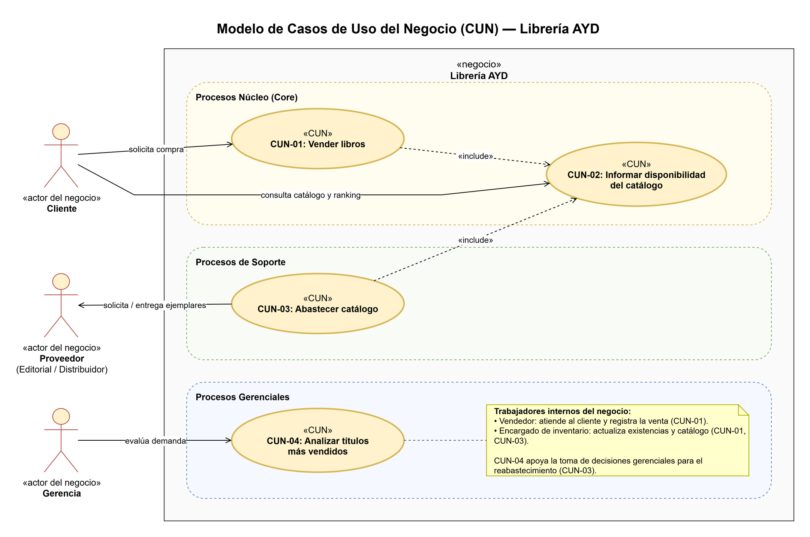
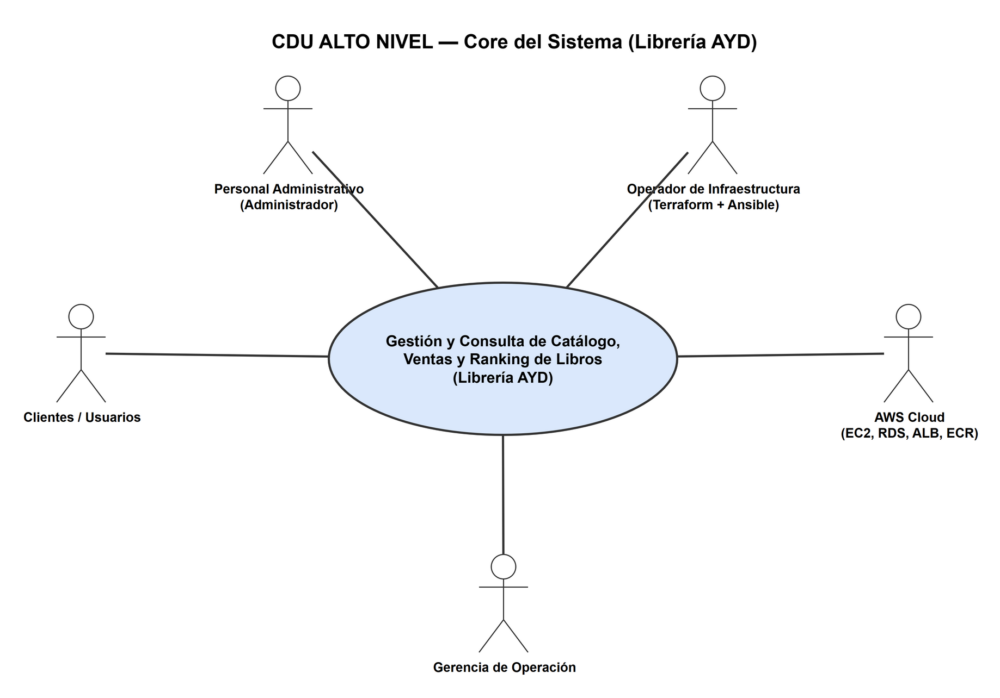
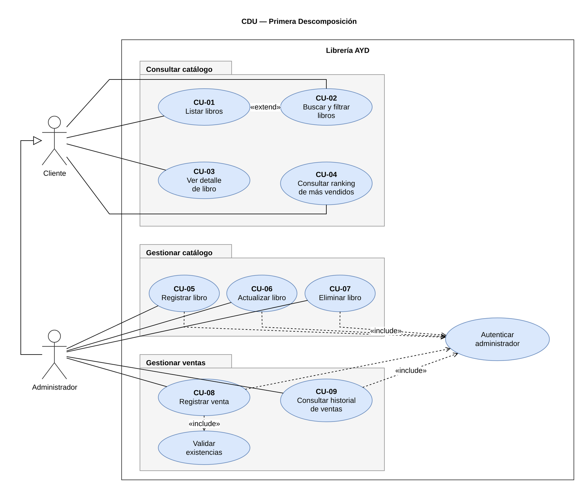

# 01 · Requerimientos y drivers de arquitectura

## 1. Contexto del negocio

La Librería AYD necesita una plataforma web para que su personal administrativo gestione el
catálogo de libros y registre las ventas, y para que sus clientes consulten los títulos
disponibles y los más vendidos. Hoy esta información se lleva de forma manual, lo que hace
difícil saber qué títulos tienen existencias y cuáles se venden más.

### 1.1 Objetivo del sistema

Ofrecer un catálogo consultable en línea, con búsqueda por título o autor, y un ranking de
los libros más vendidos que se actualice a partir de las transacciones registradas.

### 1.2 Alcance

| Incluye | No incluye |
|---------|------------|
| Consulta del catálogo (título, autor, precio, existencias) | Pagos en línea o pasarela de pago |
| Búsqueda y filtrado por título o autor | Carrito de compras para clientes |
| Registro de ventas por personal administrativo | Facturación electrónica |
| Ranking de libros más vendidos | Gestión de usuarios y contraseñas |
| Administración del catálogo (crear, editar, eliminar) | Envíos o logística |

### 1.3 Características del sistema

| ID | Característica | Descripción |
|----|----------------|-------------|
| CAR-01 | Catálogo en línea | Listado paginado con título, autor, precio y existencias. |
| CAR-02 | Búsqueda y filtrado | Búsqueda por título o autor sin distinguir mayúsculas ni tildes; filtros por autor, precio y disponibilidad. |
| CAR-03 | Ranking de más vendidos | Calculado a partir del historial de ventas, filtrable por período. |
| CAR-04 | Administración del catálogo | Alta, edición y baja de libros protegidas por llave de administración. |
| CAR-05 | Registro de ventas | Cada venta descuenta existencias de forma atómica y queda en el historial. |
| CAR-06 | Arquitectura de microservicios | Libros y Ventas independientes detrás de una API Gateway, cada uno con su base de datos. |
| CAR-07 | Infraestructura como código | Toda la nube se crea con Terraform y se configura con Ansible, de forma reproducible. |
| CAR-08 | Contenedores | Todos los componentes se distribuyen como imágenes Docker en un registro privado. |

## 2. Stakeholders

| Stakeholder | Interés | Influencia |
|-------------|---------|------------|
| Gerencia de la librería | Saber qué títulos se venden más para decidir compras | Alta |
| Personal administrativo | Mantener el catálogo al día y registrar ventas rápido | Alta |
| Clientes | Encontrar libros disponibles y ver recomendaciones (más vendidos) | Media |
| Equipo de desarrollo (Grupo 4) | Construir y operar la plataforma | Alta |
| Auxiliar y catedrática del curso | Evaluar arquitectura, IaC y despliegue | Alta |

## 3. Actores

| Actor | Tipo | Descripción |
|-------|------|-------------|
| Cliente | Primario, humano | Persona que consulta el catálogo, busca libros y revisa el ranking. No se autentica. |
| Administrador | Primario, humano | Personal de la librería. Además de consultar, gestiona el catálogo y registra ventas. Se identifica con una llave de administración. |
| Operador de infraestructura | Secundario, humano | Integrante del equipo que aprovisiona y despliega la plataforma con Terraform y Ansible. |
| AWS | Secundario, sistema externo | Proveedor de nube que aloja máquinas virtuales, balanceador, bases de datos y registro de contenedores. |

El **Administrador** es una especialización del **Cliente**: puede hacer todo lo que hace un
cliente y además las tareas de gestión.

## 4. Modelo de casos de uso del negocio

Describe los procesos de la librería **independientemente del sistema**: qué hace el negocio
para dar valor a sus actores. Los casos de uso del sistema (sección 5) automatizan parte de
estos procesos.

| Actor del negocio | Rol |
|-------------------|-----|
| Cliente | Compra libros y quiere saber qué hay disponible y qué es popular. |
| Proveedor | Editorial o distribuidor que abastece los títulos. |
| Gerencia | Decide qué títulos reabastecer según las ventas. |

| Trabajador del negocio | Rol |
|------------------------|-----|
| Vendedor | Atiende al cliente y registra la venta. |
| Encargado de inventario | Mantiene el catálogo y las existencias. |

| Código | Caso de uso del negocio | Actor | Tipo | Automatizado por |
|--------|-------------------------|-------|------|------------------|
| CUN-01 | Vender libros | Cliente | Núcleo | CU-08, CU-09 |
| CUN-02 | Informar disponibilidad del catálogo | Cliente | Núcleo | CU-01, CU-02, CU-03 |
| CUN-03 | Abastecer catálogo | Proveedor | Soporte | CU-05, CU-06, CU-07 |
| CUN-04 | Analizar títulos más vendidos | Gerencia | Gerencial | CU-04 |

### 4.1 CUN-01 · Vender libros (expandido)

| Campo | Detalle |
|-------|---------|
| Nombre | Vender libros |
| Actores | Cliente (actor del negocio); Vendedor y Encargado de inventario (trabajadores) |
| Propósito | Entregar al cliente los libros que solicita y dejar constancia de la venta. |
| Resumen | Inicia cuando el cliente pide uno o más títulos. El vendedor confirma la disponibilidad, cobra y registra la venta; termina cuando el cliente recibe los libros y las existencias quedan actualizadas. |
| Prioridad | Alta |
| Mejoras | Hoy la disponibilidad se revisa a mano en estanterías y la venta se anota en papel; la plataforma lo hace en línea y alimenta el ranking. |

**Curso normal**

| Acción del actor | Respuesta del negocio |
|------------------|-----------------------|
| 1. El cliente solicita uno o más títulos. | |
| | 2. El vendedor busca el título en el catálogo. |
| | 3. El vendedor confirma que hay existencias suficientes. |
| | 4. El vendedor cobra y registra la venta con la fecha. |
| | 5. El encargado de inventario ve reflejada la baja de existencias. |
| 6. El cliente recibe los libros. | |

**Cursos alternos**

- 3a. No hay existencias suficientes: el vendedor ofrece la cantidad disponible o un título similar; si el cliente no acepta, no se registra la venta.
- 2a. El título no está en el catálogo: el vendedor lo anota como solicitud para CUN-03.

## 5. Casos de uso del sistema de alto nivel

### 5.1 Core del sistema

El **Administrador** especializa al **Cliente**: hereda la consulta del catálogo y agrega la
gestión del catálogo y de las ventas.

### 5.2 Primera descomposición

| Código | Caso de uso | Actor | Microservicio |
|--------|-------------|-------|---------------|
| CU-01 | Listar libros | Cliente, Administrador | Libros |
| CU-02 | Buscar y filtrar libros | Cliente, Administrador | Libros |
| CU-03 | Ver detalle de libro | Cliente, Administrador | Libros |
| CU-04 | Consultar ranking de más vendidos | Cliente, Administrador | Ventas |
| CU-05 | Registrar libro | Administrador | Libros |
| CU-06 | Actualizar libro | Administrador | Libros |
| CU-07 | Eliminar libro | Administrador | Libros |
| CU-08 | Registrar venta | Administrador | Ventas (+ Libros) |
| CU-09 | Consultar historial de ventas | Administrador | Ventas |

## 6. Casos de uso del sistema expandidos (drivers funcionales)

### CU-01 · Listar libros

| Campo | Detalle |
|-------|---------|
| Actores | Cliente, Administrador |
| Propósito | Mostrar los libros del catálogo con título, autor, precio y existencias. |
| Resumen | Inicia cuando el usuario entra al catálogo y termina cuando ve la página de libros solicitada, ordenada y con el total de resultados. |
| Prioridad | Alta |
| Mejoras | Reemplaza la consulta manual en estanterías; la información de existencias está siempre al día. |
| Precondición | El microservicio de Libros está disponible. |
| Postcondición | El usuario ve una página del catálogo. |
| Requisitos | RF-01, RF-02, RNF-02 |

**Flujo principal**

| Actor | Sistema |
|-------|---------|
| 1. Ingresa a la página de catálogo. | |
| | 2. La API Gateway enruta `GET /api/v1/libros` al microservicio de Libros. |
| | 3. Devuelve la primera página (20 libros por defecto) ordenada por título. |
| 4. Revisa el listado y cambia de página si lo necesita. | |
| | 5. Devuelve la página solicitada con el total de resultados. |

**Flujos alternos**

- 3a. No hay libros registrados: se muestra el mensaje "No hay libros en el catálogo".
- 2a. El microservicio no responde: la API Gateway responde `503` y el frontend muestra un aviso de servicio no disponible.

### CU-02 · Buscar y filtrar libros

| Campo | Detalle |
|-------|---------|
| Actores | Cliente, Administrador |
| Propósito | Localizar libros por título o autor. |
| Resumen | Inicia cuando el usuario escribe o elige un filtro y termina cuando el listado muestra solo los libros que coinciden con todos los criterios. |
| Prioridad | Alta |
| Mejoras | Búsqueda tolerante a tildes y mayúsculas; los filtros quedan en la URL para compartir la búsqueda. |
| Precondición | El usuario está en la vista de catálogo. |
| Postcondición | El listado muestra solo los libros que coinciden. |
| Requisitos | RF-03, RF-04, RF-05, RNF-02 |

**Flujo principal**

| Actor | Sistema |
|-------|---------|
| 1. Escribe un texto en el buscador. | |
| | 2. Espera 300 ms sin escritura y envía `GET /api/v1/libros?q=<texto>`. |
| | 3. Busca coincidencias parciales, sin distinguir mayúsculas ni tildes, en título **o** autor. |
| 4. Opcionalmente filtra por autor, rango de precio o solo con existencias. | |
| | 5. Combina los filtros (`autor`, `precioMin`, `precioMax`, `disponibles`) y devuelve el resultado. |

**Flujos alternos**

- 3a. Sin coincidencias: se muestra "No se encontraron libros para «texto»" con opción de limpiar filtros.
- 5a. Rango de precio inválido (`precioMin > precioMax`): responde `400` con el detalle del error.

### CU-04 · Consultar ranking de más vendidos

| Campo | Detalle |
|-------|---------|
| Actores | Cliente, Administrador |
| Propósito | Conocer los títulos con más unidades vendidas. |
| Resumen | Inicia cuando el usuario abre «Más vendidos» y termina cuando ve el top de libros del período elegido. |
| Prioridad | Alta |
| Mejoras | La gerencia deja de calcular el ranking a mano; los clientes reciben recomendaciones basadas en ventas reales. |
| Precondición | El microservicio de Ventas está disponible. |
| Postcondición | Se muestra el top de libros ordenado por unidades vendidas. |
| Requisitos | RF-09, RF-10, RNF-02 |

**Flujo principal**

| Actor | Sistema |
|-------|---------|
| 1. Ingresa a la vista "Más vendidos". | |
| | 2. Envía `GET /api/v1/ventas/ranking?limite=10`. |
| | 3. Agrupa las ventas por libro, suma unidades e ingresos y ordena de mayor a menor. |
| | 4. Devuelve posición, título, autor, unidades vendidas y monto total. |
| 5. Opcionalmente filtra por rango de fechas. | |
| | 6. Recalcula el ranking solo con las ventas del periodo. |

**Flujos alternos**

- 3a. No hay ventas registradas: se devuelve una lista vacía y el frontend muestra "Aún no hay ventas registradas".
- 3b. Empate en unidades: se desempata por monto total y luego por título, para que el orden sea estable.

### CU-05 · Registrar libro

| Campo | Detalle |
|-------|---------|
| Actores | Administrador |
| Propósito | Agregar un título nuevo al catálogo. |
| Resumen | Inicia cuando el administrador abre el formulario de nuevo libro y termina cuando el libro queda visible en el catálogo. |
| Prioridad | Alta |
| Mejoras | Validación inmediata de datos e ISBN único; el catálogo se actualiza para todos al instante. |
| Precondición | El administrador envía la llave de administración válida. |
| Postcondición | El libro queda disponible en el catálogo. |
| Requisitos | RF-06, RNF-04 |

**Flujo principal**

| Actor | Sistema |
|-------|---------|
| 1. Completa título, autor, ISBN, precio y existencias. | |
| | 2. La API Gateway valida la llave `X-Api-Key` y enruta `POST /api/v1/libros`. |
| | 3. Valida los datos: título y autor obligatorios, precio > 0, existencias ≥ 0, ISBN único. |
| | 4. Guarda el libro y responde `201` con el recurso creado. |

**Flujos alternos**

- 2a. Llave ausente o incorrecta: responde `401` sin llegar al microservicio.
- 3a. Datos inválidos: responde `400` con la lista de campos con error.
- 3b. ISBN duplicado: responde `409`.

### CU-08 · Registrar venta

| Campo | Detalle |
|-------|---------|
| Actores | Administrador |
| Propósito | Registrar la venta de un libro para que cuente en el ranking. |
| Resumen | Inicia cuando el administrador elige un libro y una cantidad, y termina cuando la venta queda registrada y las existencias disminuyen, o se rechaza sin cambiar nada. |
| Prioridad | Alta |
| Mejoras | El descuento atómico evita vender unidades inexistentes, incluso con ventas simultáneas; cada venta alimenta el ranking. |
| Precondición | El libro existe y el administrador envía la llave válida. |
| Postcondición | La venta queda guardada con fecha y las existencias del libro disminuyen. |
| Requisitos | RF-07, RF-08, RNF-04, RNF-05 |
| Incluye | Validar existencias |

**Flujo principal**

| Actor | Sistema |
|-------|---------|
| 1. Selecciona el libro e ingresa la cantidad. | |
| | 2. La API Gateway valida la llave y enruta `POST /api/v1/ventas`. |
| | 3. Ventas consulta el libro en el microservicio de Libros (precio y título vigentes). |
| | 4. Ventas solicita a Libros descontar la cantidad (**Validar existencias**). |
| | 5. Libros descuenta de forma atómica solo si hay existencias suficientes. |
| | 6. Ventas guarda la transacción con libro, cantidad, precio unitario, total y fecha. |
| | 7. Responde `201` con la venta registrada. |

**Flujos alternos**

- 3a. El libro no existe: responde `404`.
- 5a. Existencias insuficientes: responde `409` y no se guarda la venta.
- 6a. Falla al guardar la venta después de descontar: Ventas ejecuta la compensación (devuelve las existencias a Libros) y responde `500`.
- 3b. Libros no responde: responde `503` y no se guarda la venta.

## 7. Requisitos funcionales

| ID | Requisito | Prioridad |
|----|-----------|-----------|
| RF-01 | Listar los libros con título, autor, precio y existencias. | Alta |
| RF-02 | Paginar y ordenar el listado (por título, autor o precio). | Media |
| RF-03 | Buscar libros por coincidencia parcial en título o autor. | Alta |
| RF-04 | Filtrar libros por autor, rango de precio y disponibilidad. | Alta |
| RF-05 | Consultar el detalle de un libro. | Media |
| RF-06 | Crear, actualizar y eliminar libros (solo administrador). | Alta |
| RF-07 | Registrar ventas con libro, cantidad y fecha (solo administrador). | Alta |
| RF-08 | Descontar existencias al registrar una venta y rechazarla si no alcanzan. | Alta |
| RF-09 | Calcular el ranking de libros más vendidos a partir del historial. | Alta |
| RF-10 | Filtrar el ranking por rango de fechas y limitar el número de resultados. | Media |
| RF-11 | Consultar el historial de ventas paginado (solo administrador). | Media |

## 8. Drivers de atributos de calidad

Cada atributo se expresa como un escenario: **estímulo → respuesta → medida**.

| ID | Atributo | Escenario | Medida | Táctica aplicada |
|----|----------|-----------|--------|------------------|
| RNF-01 | Disponibilidad | Un contenedor de un microservicio se detiene inesperadamente. | Docker lo reinicia en menos de 30 s; el ALB deja de enviarle tráfico mientras su *health check* falla. | Política `restart: unless-stopped`, *health checks* en ALB y en contenedores. |
| RNF-02 | Rendimiento | Un cliente busca un libro con 50 usuarios concurrentes. | El percentil 95 de respuesta es menor a 500 ms. | Índices de búsqueda en PostgreSQL, paginación obligatoria, conexiones persistentes del gateway a los servicios, compresión gzip en Nginx. |
| RNF-03 | Escalabilidad | Aumenta el tráfico en el catálogo. | Se puede agregar otra instancia de Libros detrás del gateway sin cambiar código, y escalar RDS verticalmente. | Servicios sin estado, configuración por variables de entorno, base de datos gestionada. |
| RNF-04 | Seguridad | Un usuario sin llave intenta crear un libro o una venta. | La API Gateway responde `401` y la petición nunca llega al microservicio. | Autenticación en el borde, grupos de seguridad que solo permiten tráfico interno a los microservicios, bases de datos en subred privada. |
| RNF-05 | Consistencia | Dos ventas simultáneas compiten por la última unidad de un libro. | Solo una se registra; la otra recibe `409`. | Descuento atómico (`UPDATE ... WHERE existencias >= cantidad`) y compensación ante fallos. |
| RNF-06 | Mantenibilidad | Se necesita cambiar la base de datos de un servicio. | El cambio se limita a la capa de acceso a datos de ese servicio. | Arquitectura por capas, base de datos por servicio, contratos OpenAPI. |
| RNF-07 | Portabilidad / reproducibilidad | Se necesita recrear el entorno desde cero. | `terraform apply` + `ansible-playbook` levantan todo sin pasos manuales en menos de 30 min. | Infraestructura como código, imágenes Docker versionadas en ECR. |
| RNF-08 | Observabilidad | Un error ocurre en una petición que pasa por varios servicios. | Se puede rastrear con un único identificador en los logs de todos los servicios. | Encabezado `X-Request-Id` propagado por el gateway, logs estructurados en JSON. |

## 9. Drivers de restricción

| ID | Restricción | Origen |
|----|-------------|--------|
| RES-01 | Patrón de microservicios sobre arquitectura por capas, con dos servicios: Libros y Ventas. | Enunciado |
| RES-02 | API Gateway como punto de entrada único. | Enunciado |
| RES-03 | Infraestructura definida con Terraform: red, máquinas virtuales, IP públicas estáticas, balanceador y bases de datos gestionadas. | Enunciado |
| RES-04 | Configuración de sistema operativo, instalación de Docker Engine y despliegue con Ansible. | Enunciado |
| RES-05 | Todos los componentes en contenedores Docker publicados en un registro en la nube. | Enunciado |
| RES-06 | Nube pública: AWS. | Decisión del equipo |
| RES-07 | Una base de datos independiente por microservicio. | Enunciado / patrón |
| RES-08 | Documentación en Markdown dentro del repositorio. | Enunciado |
| RES-09 | Fecha de entrega: 22 de octubre de 2026. | Cronograma |

## 10. Matrices de trazabilidad

### 10.1 Casos de uso ↔ requisitos funcionales

| CU \ RF | RF-01 | RF-02 | RF-03 | RF-04 | RF-05 | RF-06 | RF-07 | RF-08 | RF-09 | RF-10 | RF-11 |
|---------|:-----:|:-----:|:-----:|:-----:|:-----:|:-----:|:-----:|:-----:|:-----:|:-----:|:-----:|
| CU-01 | ● | ● | | | | | | | | | |
| CU-02 | | | ● | ● | | | | | | | |
| CU-03 | | | | | ● | | | | | | |
| CU-04 | | | | | | | | | ● | ● | |
| CU-05 | | | | | | ● | | | | | |
| CU-06 | | | | | | ● | | | | | |
| CU-07 | | | | | | ● | | | | | |
| CU-08 | | | | | | | ● | ● | | | |
| CU-09 | | | | | | | | | | | ● |

### 10.2 Requisitos ↔ componentes

| Requisito | Frontend | API Gateway | Libros | Ventas | RDS | Terraform | Ansible |
|-----------|:--------:|:-----------:|:------:|:------:|:---:|:---------:|:-------:|
| RF-01 – RF-05 | ● | ● | ● | | ● | | |
| RF-06 | ● | ● | ● | | ● | | |
| RF-07, RF-08 | ● | ● | ● | ● | ● | | |
| RF-09 – RF-11 | ● | ● | | ● | ● | | |
| RNF-01 | | ● | ● | ● | | ● | ● |
| RNF-04 | | ● | | | ● | ● | |
| RNF-05 | | | ● | ● | ● | | |
| RNF-07 | | | | | | ● | ● |
| RNF-08 | | ● | ● | ● | | | |

### 10.3 Casos de uso del negocio ↔ casos de uso del sistema

| CUN \ CU | CU-01 | CU-02 | CU-03 | CU-04 | CU-05 | CU-06 | CU-07 | CU-08 | CU-09 |
|----------|:-----:|:-----:|:-----:|:-----:|:-----:|:-----:|:-----:|:-----:|:-----:|
| CUN-01 Vender libros | | | | | | | | ● | ● |
| CUN-02 Informar disponibilidad | ● | ● | ● | | | | | | |
| CUN-03 Abastecer catálogo | | | | | ● | ● | ● | | |
| CUN-04 Analizar más vendidos | | | | ● | | | | | |

### 10.4 Componentes ↔ responsables

| Componente | Responsable | Carnet |
|------------|-------------|--------|
| Arquitectura, contratos, API Gateway, integración | Carlos Javier Pérez Pocón | 202206425 |
| Microservicio de Libros | Luis Fernando González | 202307727 |
| Microservicio de Ventas | Eduardo Misael López Ávila | 202100147 |
| Frontend y manual de usuario | Kevin Mark Hernández Chicol | 202001053 |
| Terraform, Ansible, ECR, despliegue | Billy James Asael Chamale Sánchez | 201907502 |
