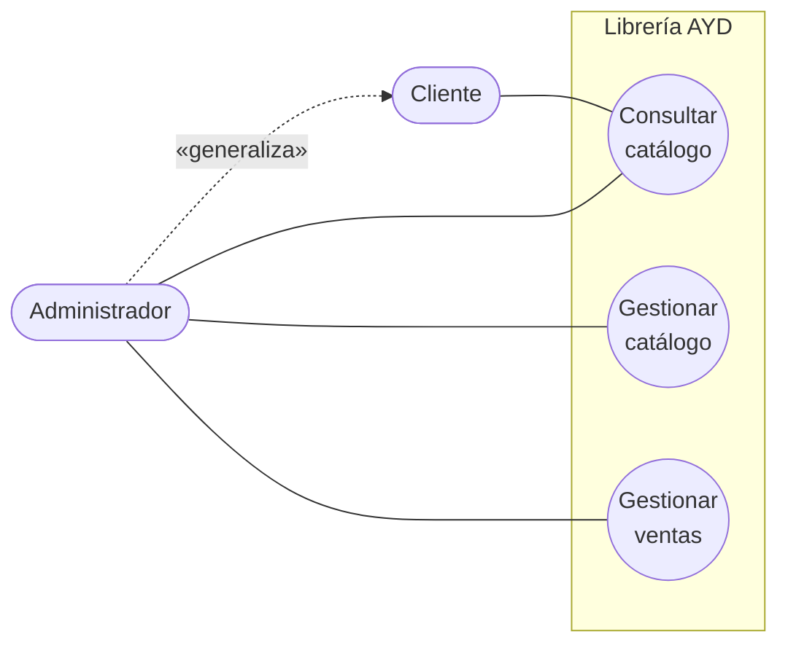

# 01 · Requerimientos y drivers de arquitectura

## 1. Contexto del negocio

La Librería AYD necesita una plataforma web para que su personal administrativo gestione el
catálogo de libros y registre las ventas, y para que sus clientes consulten los títulos
disponibles y los más vendidos. Hoy esta información se lleva de forma manual, lo que hace
difícil saber qué títulos tienen existencias y cuáles se venden más.

### 1.1 Objetivo del sistema

Ofrecer un catálogo consultable en línea, con búsqueda por título o autor, y un ranking de
los libros más vendidos que se actualice a partir de las transacciones registradas.

### 1.2 Alcance

| Incluye | No incluye |
|---------|------------|
| Consulta del catálogo (título, autor, precio, existencias) | Pagos en línea o pasarela de pago |
| Búsqueda y filtrado por título o autor | Carrito de compras para clientes |
| Registro de ventas por personal administrativo | Facturación electrónica |
| Ranking de libros más vendidos | Gestión de usuarios y contraseñas |
| Administración del catálogo (crear, editar, eliminar) | Envíos o logística |

## 2. Stakeholders

| Stakeholder | Interés | Influencia |
|-------------|---------|------------|
| Gerencia de la librería | Saber qué títulos se venden más para decidir compras | Alta |
| Personal administrativo | Mantener el catálogo al día y registrar ventas rápido | Alta |
| Clientes | Encontrar libros disponibles y ver recomendaciones (más vendidos) | Media |
| Equipo de desarrollo (Grupo 4) | Construir y operar la plataforma | Alta |
| Auxiliar y catedrática del curso | Evaluar arquitectura, IaC y despliegue | Alta |

## 3. Actores

| Actor | Tipo | Descripción |
|-------|------|-------------|
| Cliente | Primario, humano | Persona que consulta el catálogo, busca libros y revisa el ranking. No se autentica. |
| Administrador | Primario, humano | Personal de la librería. Además de consultar, gestiona el catálogo y registra ventas. Se identifica con una llave de administración. |
| Operador de infraestructura | Secundario, humano | Integrante del equipo que aprovisiona y despliega la plataforma con Terraform y Ansible. |
| AWS | Secundario, sistema externo | Proveedor de nube que aloja máquinas virtuales, balanceador, bases de datos y registro de contenedores. |

El **Administrador** es una especialización del **Cliente**: puede hacer todo lo que hace un
cliente y además las tareas de gestión.

## 4. Casos de uso de alto nivel

### 4.1 Core del sistema

### 4.2 Primera descomposición

| Código | Caso de uso | Actor | Microservicio |
|--------|-------------|-------|---------------|
| CU-01 | Listar libros | Cliente, Administrador | Libros |
| CU-02 | Buscar y filtrar libros | Cliente, Administrador | Libros |
| CU-03 | Ver detalle de libro | Cliente, Administrador | Libros |
| CU-04 | Consultar ranking de más vendidos | Cliente, Administrador | Ventas |
| CU-05 | Registrar libro | Administrador | Libros |
| CU-06 | Actualizar libro | Administrador | Libros |
| CU-07 | Eliminar libro | Administrador | Libros |
| CU-08 | Registrar venta | Administrador | Ventas (+ Libros) |
| CU-09 | Consultar historial de ventas | Administrador | Ventas |
