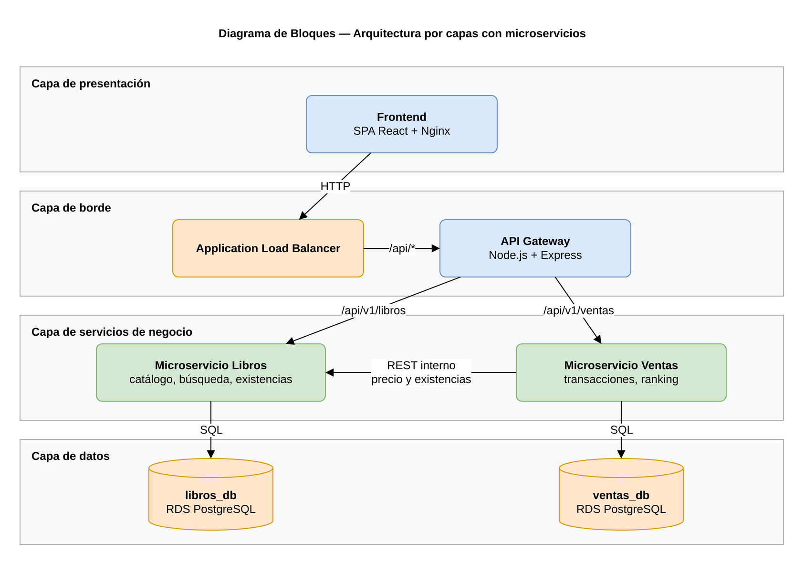
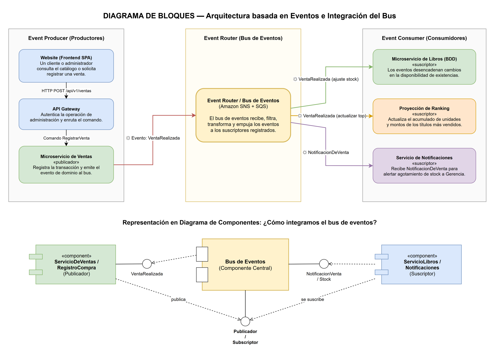
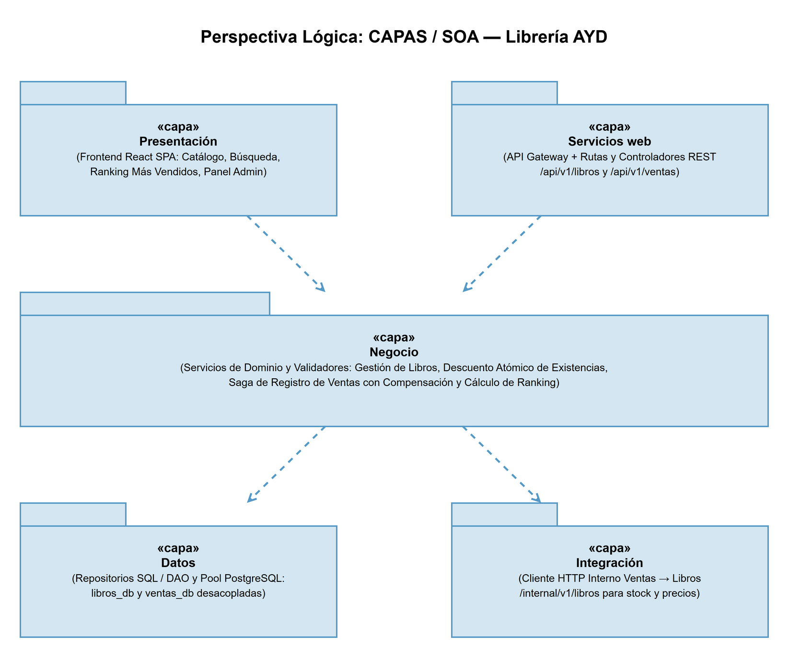
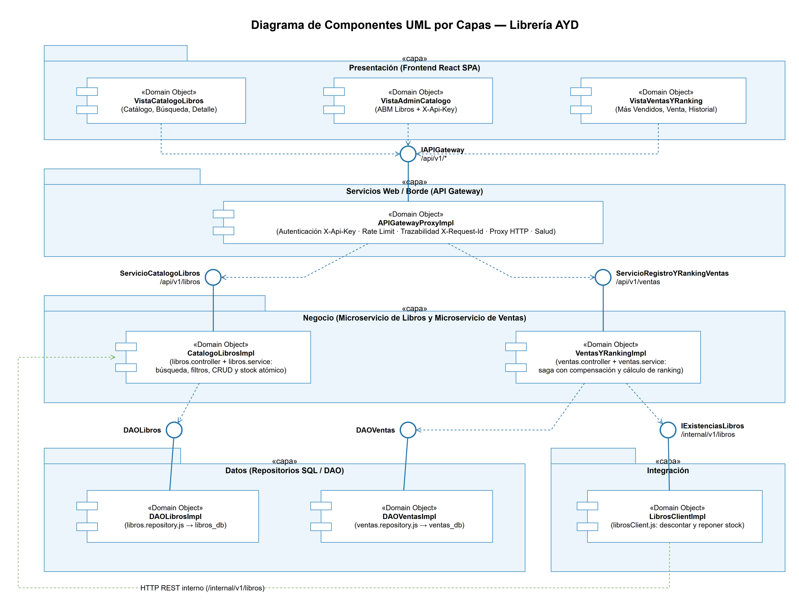
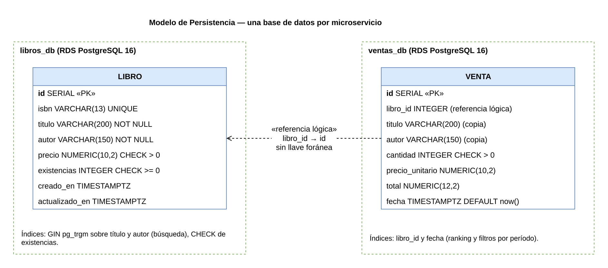
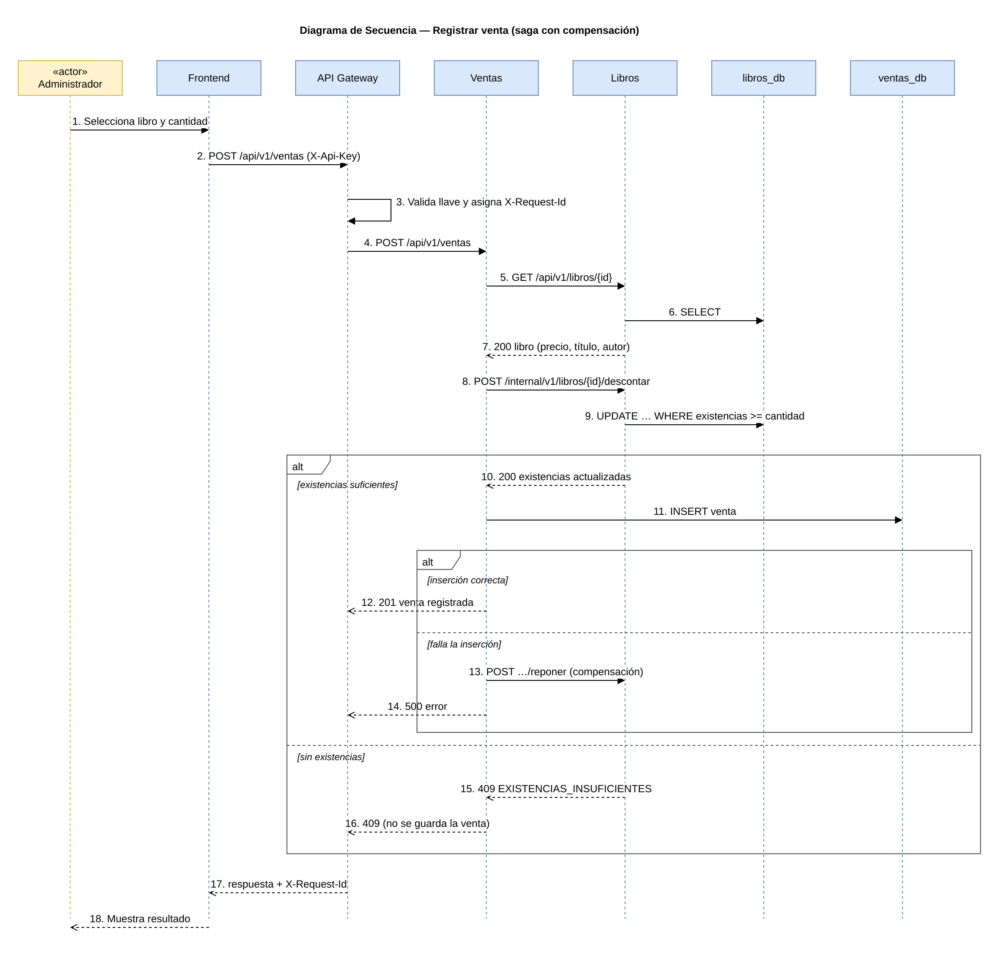

# 02 · Arquitectura lógica

## 1. Patrón arquitectónico

La plataforma combina dos patrones:

1. **Microservicios** como estilo de descomposición: el dominio se divide en dos contextos
   independientes, cada uno con su propio proceso, base de datos y ciclo de despliegue.
   - **Libros**: catálogo, búsqueda, filtrado y existencias.
   - **Ventas**: transacciones y ranking de más vendidos.
2. **Arquitectura por capas** dentro de cada microservicio, para separar transporte HTTP,
   lógica de negocio y acceso a datos.

Una **API Gateway** es el único punto de entrada para el frontend. Enruta cada petición al
microservicio dueño del recurso y aplica las preocupaciones transversales (autenticación de
administrador, límite de peticiones, CORS, trazabilidad y manejo uniforme de errores).

## 2. Diagrama de bloques



### 2.1 Perspectiva basada en eventos

La versión 1.0 registra las ventas de forma síncrona (ver [ADR-004](adr/ADR-004-comunicacion-sincrona-con-compensacion.md)).
El siguiente diagrama muestra cómo se integra un **bus de eventos** con el modelo
publicador/suscriptor cuando aparezcan más consumidores de una venta, sin cambiar los
contratos públicos:



| Elemento | Rol | Evento |
|----------|-----|--------|
| Microservicio Ventas | Publicador | Emite `VentaRegistrada` al confirmar una venta. |
| Bus de eventos (SNS + SQS) | Componente central | Recibe `VentaRegistrada`, la distribuye y deriva `NotificacionDeVenta`. |
| Microservicio Libros | Suscriptor | Podría ajustar existencias de forma asíncrona. |
| Proyección de ranking | Suscriptor (futuro) | Mantiene una vista materializada del ranking. |
| Notificaciones | Suscriptor (futuro) | Avisa a la gerencia de ventas relevantes. |

Beneficios esperados: comunicación desacoplada, posibilidad de agregar suscriptores sin
tocar Ventas y escalado independiente del procesamiento de eventos.

### 2.2 Reglas de dependencia

- El frontend solo conoce la API Gateway.
- Un microservicio nunca accede a la base de datos de otro; si necesita datos ajenos, usa la API del dueño.
- La única dependencia entre servicios es **Ventas → Libros**, para obtener el precio vigente y descontar existencias.

## 3. Perspectiva lógica: CAPAS / SOA y capas de cada microservicio

Desde la perspectiva lógica CAPAS / SOA, el sistema se organiza en cinco paquetes con estereotipo `«capa»`:



| Capa (`«capa»`) | Responsabilidad principal | Elementos que la integran |
|-----------------|---------------------------|---------------------------|
| **Presentación** | Interacción con el cliente y el administrador en el navegador web. | Aplicación React 18 SPA (`frontend`): vistas de Catálogo, Más vendidos y Administración. |
| **Servicios web** | Exposición de contratos REST, enrutamiento, autenticación `X-Api-Key`, *rate limit* y trazabilidad. | `api-gateway` (`/api/v1/*`) + capas `routes` y `controllers` de Libros y Ventas. |
| **Negocio** | Aplicación de reglas de dominio, validaciones, descuento atómico de existencias, saga de ventas con compensación y cálculo del ranking. | Capas `validators` y `services` (`libros.service.js`, `ventas.service.js`). |
| **Datos** | Acceso a datos mediante SQL parametrizado y mapeo de filas a objetos de dominio sin lógica de negocio. | Capa `repositories` (`libros.repository.js` → `libros_db`, `ventas.repository.js` → `ventas_db`). |
| **Integración** | Comunicación HTTP interna entre microservicios con manejo de *timeouts* y errores. | Capa `clients` (`librosClient.js` en Ventas hacia `/internal/v1/libros`). |

Dentro de cada microservicio (**Libros** y **Ventas**), esta separación lógica se materializa en la siguiente estructura interna:

| Subcapa interna | Paquete `«capa»` | Responsabilidad | No debe |
|-----------------|------------------|-----------------|---------|
| `routes` | Servicios web | Declarar endpoints y asociarlos a controladores. | Contener lógica. |
| `controllers` | Servicios web | Leer parámetros, llamar al servicio y armar la respuesta HTTP. | Hablar con la base de datos. |
| `validators` | Negocio | Validar y normalizar la entrada; producir errores `400` con detalle por campo. | Conocer la base de datos. |
| `services` | Negocio | Aplicar reglas de negocio (descuento de existencias, cálculo del ranking, compensación). | Conocer `req`/`res`. |
| `repositories` | Datos | Ejecutar SQL parametrizado y mapear filas a objetos. | Tomar decisiones de negocio. |
| `clients` | Integración | Encapsular llamadas HTTP a otros microservicios (solo Ventas). | Exponerse fuera del servicio. |

Estructura de carpetas esperada:

```
services/<servicio>/
├── src/
│   ├── app.js            # crea la app Express (sin escuchar puerto)
│   ├── server.js         # arranque, conexión a BD y apagado ordenado
│   ├── config/           # variables de entorno validadas
│   ├── routes/
│   ├── controllers/
│   ├── validators/
│   ├── services/
│   ├── repositories/
│   ├── clients/          # solo ventas
│   ├── middlewares/      # requestId, errores, 404
│   └── db/               # pool, migraciones y datos semilla
├── tests/
├── Dockerfile
└── package.json
```

## 4. Diagrama de componentes

Fuente editable: [`docs/diagramas/componentes.drawio`](../diagramas/componentes.drawio). Los componentes (`«Domain Object»`) se agrupan dentro de sus respectivos paquetes `«capa»` (`Presentación`, `Servicios Web / Borde`, `Negocio`, `Datos` e `Integración`), y cada conector une una **interfaz provista** (círculo) con el componente que la **requiere** (flecha discontinua de dependencia).



| Interfaz | Provista por (`«Domain Object»`) | Requerida por (`«Domain Object»`) |
|----------|----------------------------------|-----------------------------------|
| `IAPIGateway` (`/api/v1/*`) | `APIGatewayProxyImpl` (Servicios Web) | `VistaCatalogoLibros`, `VistaAdminCatalogo`, `VistaVentasYRanking` (Presentación) |
| `ServicioCatalogoLibros` (`/api/v1/libros`) | `CatalogoLibrosImpl` (Negocio Libros) | `APIGatewayProxyImpl` (Servicios Web) |
| `ServicioRegistroYRankingVentas` (`/api/v1/ventas`) | `VentasYRankingImpl` (Negocio Ventas) | `APIGatewayProxyImpl` (Servicios Web) |
| `DAOLibros` | `DAOLibrosImpl` (Datos Libros) | `CatalogoLibrosImpl` (Negocio Libros) |
| `DAOVentas` | `DAOVentasImpl` (Datos Ventas) | `VentasYRankingImpl` (Negocio Ventas) |
| `IExistenciasLibros` (`/internal/v1/libros`) | `LibrosClientImpl` (Integración) → `CatalogoLibrosImpl` | `VentasYRankingImpl` (Negocio Ventas) |

La API interna de Libros (`/internal/v1/...`) solo la usa Ventas. La API Gateway **bloquea**
cualquier petición externa a rutas `/internal`, y en la nube los grupos de seguridad solo
permiten tráfico hacia Libros desde el gateway y desde la VM de Ventas.

## 5. Modelo de persistencia

Cada microservicio tiene **su propia base de datos PostgreSQL**, aprovisionada en Amazon RDS
con Terraform. No existen llaves foráneas entre bases: `ventas.libro_id` es una referencia
lógica al identificador del libro en el servicio de Libros.



### 5.1 `libros_db`

Índices:

- `idx_libro_titulo_trgm` y `idx_libro_autor_trgm` (GIN con `pg_trgm` sobre `unaccent(lower(...))`) para la búsqueda parcial.
- `CHECK (existencias >= 0)` como última defensa contra existencias negativas.

### 5.2 `ventas_db`

Se guarda una copia de título, autor y precio porque la venta es un **hecho histórico**: si
después cambia el precio o se elimina el libro, el ranking y el historial siguen siendo
correctos sin consultar a Libros.

Índices: `idx_venta_libro_id`, `idx_venta_fecha`.

### 5.3 Cálculo del ranking

```sql
SELECT libro_id,
       (ARRAY_AGG(titulo ORDER BY fecha DESC, id DESC))[1] AS titulo,
       (ARRAY_AGG(autor  ORDER BY fecha DESC, id DESC))[1] AS autor,
       SUM(cantidad) AS unidades_vendidas,
       SUM(total)    AS monto_total
FROM venta
WHERE fecha >= COALESCE($1, '-infinity') AND fecha < COALESCE($2, 'infinity')
GROUP BY libro_id
ORDER BY unidades_vendidas DESC, monto_total DESC, titulo ASC
LIMIT $3;
```

Se agrupa **solo por `libro_id`**: si un libro cambia de título, sus ventas anteriores y
posteriores suman en una sola posición, mostrada con el título y autor más recientes.

El ranking se calcula al momento de la consulta a partir del historial. Con el volumen
esperado (miles de ventas) la consulta es inmediata gracias al índice por fecha; si creciera,
la evolución natural es una vista materializada refrescada al registrar ventas.

## 6. Flujo de registro de una venta



El flujo usa una **saga orquestada simple**: Ventas coordina los pasos y, si el último falla,
ejecuta la acción compensatoria (reponer existencias). Así cada servicio mantiene su
propia base de datos sin transacciones distribuidas.

## 7. Aspectos transversales

| Aspecto | Decisión |
|---------|----------|
| Formato de errores | Todos los servicios responden `{"error": {"codigo", "mensaje", "detalles", "requestId"}}`. |
| Trazabilidad | El gateway genera o respeta `X-Request-Id` y lo reenvía; cada servicio lo incluye en sus logs y en la respuesta. |
| Logs | JSON en una línea por evento (fecha, nivel, servicio, requestId, método, ruta, estado, duración). |
| Salud | `GET /health` en cada componente (proceso vivo + conexión a BD). El gateway expone `GET /health/servicios` con el estado agregado. |
| Configuración | Solo variables de entorno, validadas al arrancar ([12-Factor](https://12factor.net/es/config)). |
| Versionado de API | Prefijo `/api/v1`. Un cambio incompatible crea `/api/v2` sin romper al frontend. |
| Seguridad | Llave de administración en el gateway para operaciones de escritura; servicios y bases sin acceso público; SQL siempre parametrizado; cabeceras de seguridad con Helmet. |
| Apagado ordenado | Al recibir `SIGTERM` cada servicio deja de aceptar conexiones, termina las peticiones en curso y cierra el pool de BD. |

## 8. Pila tecnológica

| Capa | Tecnología | Justificación |
|------|-----------|---------------|
| Frontend | React 18 + Vite, Nginx | SPA ligera; Nginx sirve estáticos y resuelve rutas del cliente. |
| Gateway | Node.js 22 + Express, proxy sobre `node:http` | Proxy en *streaming* sin dependencias extra, fácil de extender con middlewares propios. |
| Microservicios | Node.js 22 + Express + `pg` | Mismo lenguaje en todo el backend; SQL explícito sin ORM. |
| Base de datos | PostgreSQL 16 en Amazon RDS | Base gestionada con respaldos automáticos y escalado vertical. |
| Contenedores | Docker, imágenes multi-etapa sobre Alpine | Imágenes pequeñas, usuario no root. |
| Registro | Amazon ECR | Integrado con IAM de las VMs. |
| IaC | Terraform ≥ 1.6, proveedor AWS 5.x | Infraestructura declarativa y reproducible. |
| Configuración | Ansible ≥ 2.15 | Sin agentes; idempotente. |
| Pruebas | `node:test` + Supertest | Ejecutor nativo de Node, sin dependencias pesadas. |

## 9. Decisiones de arquitectura

Las decisiones relevantes están registradas en [`adr/`](adr/).
