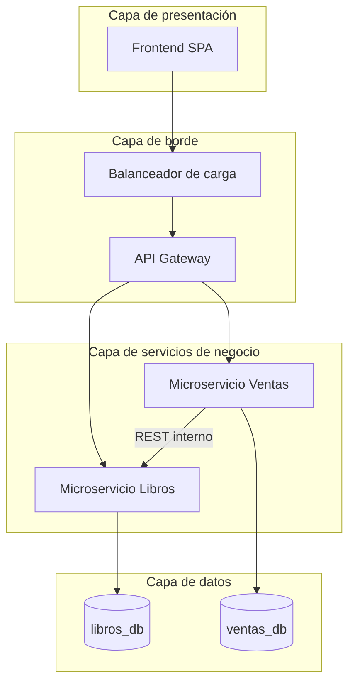
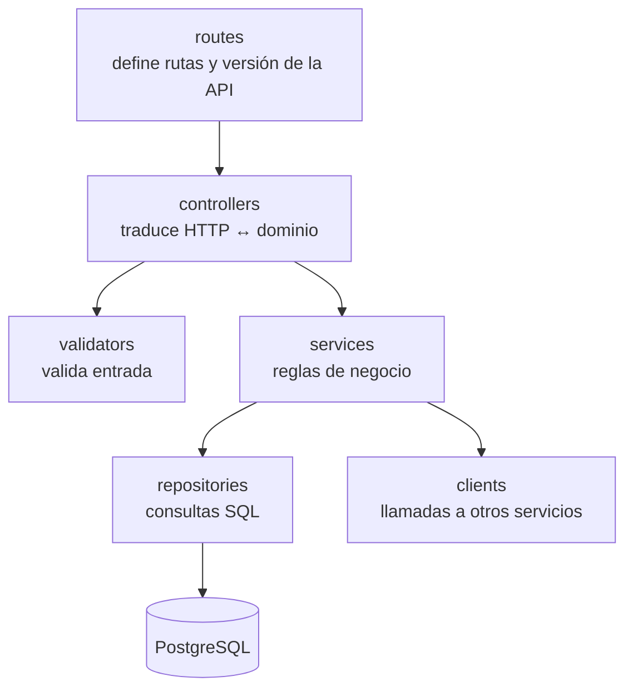
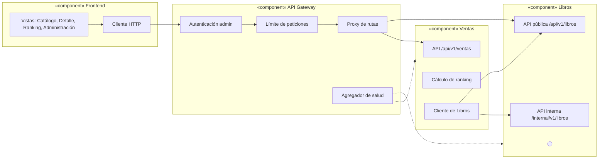

# 02 · Arquitectura lógica

## 1. Patrón arquitectónico

La plataforma combina dos patrones:

1. **Microservicios** como estilo de descomposición: el dominio se divide en dos contextos
   independientes, cada uno con su propio proceso, base de datos y ciclo de despliegue.
   - **Libros**: catálogo, búsqueda, filtrado y existencias.
   - **Ventas**: transacciones y ranking de más vendidos.
2. **Arquitectura por capas** dentro de cada microservicio, para separar transporte HTTP,
   lógica de negocio y acceso a datos.

Una **API Gateway** es el único punto de entrada para el frontend. Enruta cada petición al
microservicio dueño del recurso y aplica las preocupaciones transversales (autenticación de
administrador, límite de peticiones, CORS, trazabilidad y manejo uniforme de errores).

## 2. Diagrama de bloques



Reglas de dependencia:

- El frontend solo conoce la API Gateway.
- Un microservicio nunca accede a la base de datos de otro; si necesita datos ajenos, usa la API del dueño.
- La única dependencia entre servicios es **Ventas → Libros**, para obtener el precio vigente y descontar existencias.

## 3. Perspectiva lógica: capas de cada microservicio

Libros y Ventas tienen la misma estructura interna:



| Capa | Responsabilidad | No debe |
|------|-----------------|---------|
| `routes` | Declarar endpoints y asociarlos a controladores. | Contener lógica. |
| `controllers` | Leer parámetros, llamar al servicio y armar la respuesta HTTP. | Hablar con la base de datos. |
| `validators` | Validar y normalizar la entrada; producir errores `400` con detalle por campo. | Conocer la base de datos. |
| `services` | Aplicar reglas de negocio (descuento de existencias, cálculo del ranking, compensación). | Conocer `req`/`res`. |
| `repositories` | Ejecutar SQL parametrizado y mapear filas a objetos. | Tomar decisiones de negocio. |
| `clients` | Encapsular llamadas HTTP a otros microservicios (solo Ventas). | Exponerse fuera del servicio. |

Estructura de carpetas esperada:

```
services/<servicio>/
├── src/
│   ├── app.js            # crea la app Express (sin escuchar puerto)
│   ├── server.js         # arranque, conexión a BD y apagado ordenado
│   ├── config/           # variables de entorno validadas
│   ├── routes/
│   ├── controllers/
│   ├── validators/
│   ├── services/
│   ├── repositories/
│   ├── clients/          # solo ventas
│   ├── middlewares/      # requestId, errores, 404
│   └── db/               # pool, migraciones y datos semilla
├── tests/
├── Dockerfile
└── package.json
```

## 4. Diagrama de componentes



La API interna de Libros (`/internal/v1/...`) solo la usa Ventas. La API Gateway **bloquea**
cualquier petición externa a rutas `/internal`, y en la nube los grupos de seguridad solo
permiten tráfico hacia Libros desde el gateway y desde la VM de Ventas.
