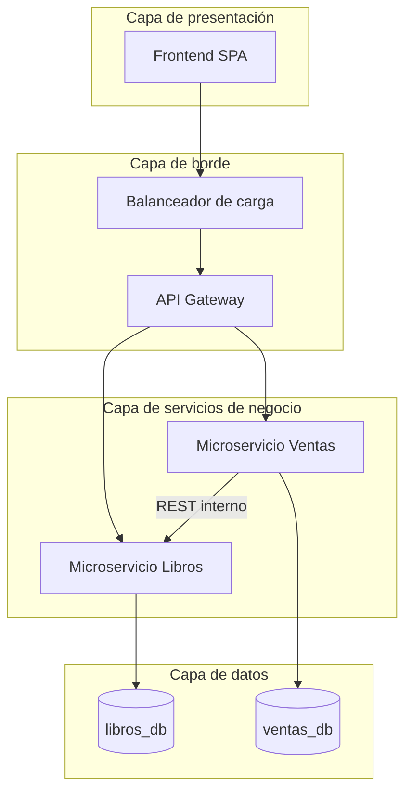

# 02 · Arquitectura lógica

## 1. Patrón arquitectónico

La plataforma combina dos patrones:

1. **Microservicios** como estilo de descomposición: el dominio se divide en dos contextos
   independientes, cada uno con su propio proceso, base de datos y ciclo de despliegue.
   - **Libros**: catálogo, búsqueda, filtrado y existencias.
   - **Ventas**: transacciones y ranking de más vendidos.
2. **Arquitectura por capas** dentro de cada microservicio, para separar transporte HTTP,
   lógica de negocio y acceso a datos.

Una **API Gateway** es el único punto de entrada para el frontend. Enruta cada petición al
microservicio dueño del recurso y aplica las preocupaciones transversales (autenticación de
administrador, límite de peticiones, CORS, trazabilidad y manejo uniforme de errores).

## 2. Diagrama de bloques

Reglas de dependencia:

- El frontend solo conoce la API Gateway.
- Un microservicio nunca accede a la base de datos de otro; si necesita datos ajenos, usa la API del dueño.
- La única dependencia entre servicios es **Ventas → Libros**, para obtener el precio vigente y descontar existencias.
