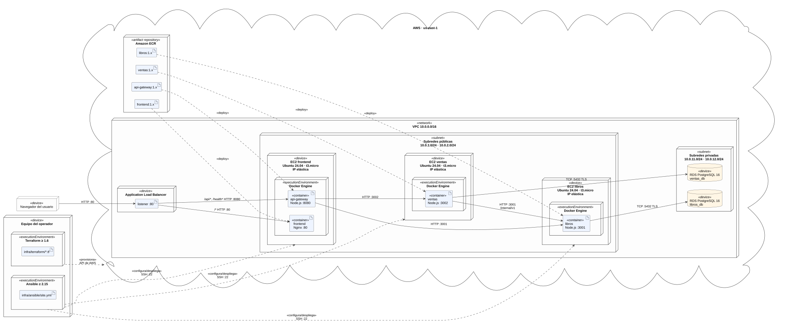
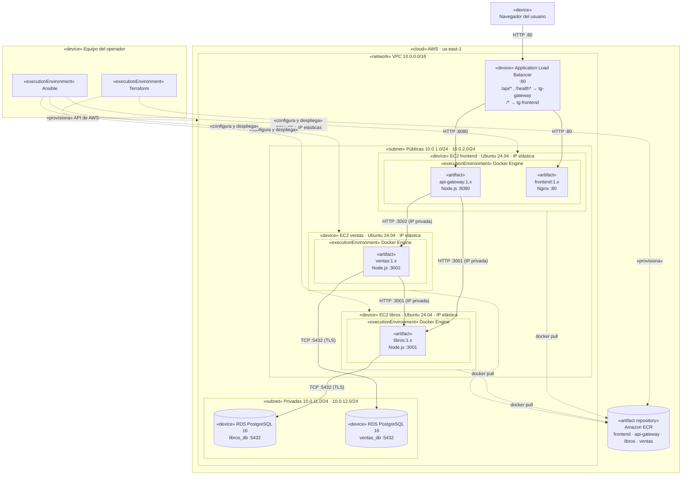
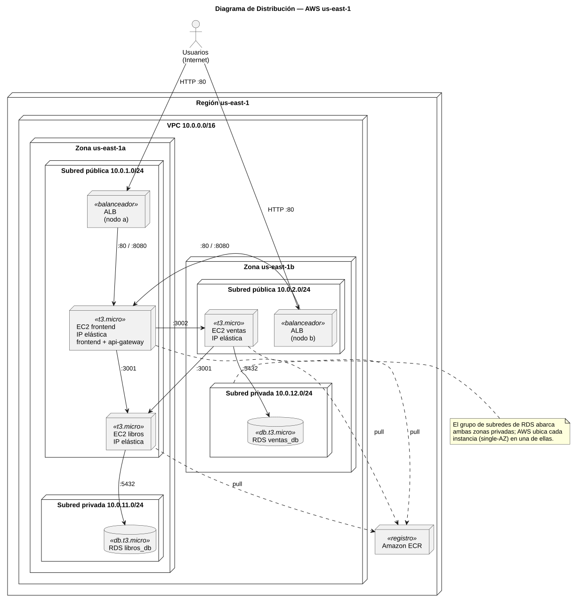
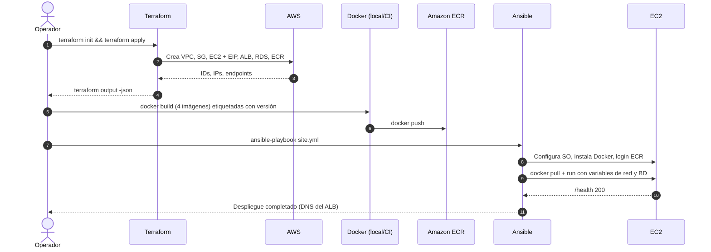

# 03 · Arquitectura de despliegue

Este documento describe cómo se distribuyen los componentes en AWS y qué parte de la
infraestructura crea **Terraform** y qué parte configura **Ansible**.

## 1. Vista general

| Elemento | Recurso AWS | Creado por |
|----------|-------------|------------|
| Red | VPC `10.0.0.0/16`, 2 subredes públicas, 2 subredes privadas, Internet Gateway, tablas de rutas | Terraform |
| Cómputo | 3 instancias EC2 Ubuntu 24.04 `t3.micro`: `frontend`, `libros`, `ventas` | Terraform |
| IP estáticas | 3 IP elásticas, una por instancia | Terraform |
| Balanceo | Application Load Balancer público, 2 *target groups* y reglas por ruta | Terraform |
| Persistencia | 2 instancias RDS PostgreSQL 16 `db.t3.micro` en subredes privadas | Terraform |
| Imágenes | 4 repositorios ECR: `frontend`, `api-gateway`, `libros`, `ventas` | Terraform |
| Permisos | Rol IAM con lectura de ECR asociado a las instancias | Terraform |
| Sistema operativo | Paquetes base, zona horaria, firewall UFW, usuario de despliegue | Ansible |
| Runtime | Docker Engine y plugin Compose desde el repositorio oficial de Docker | Ansible |
| Contenedores | Descarga de imágenes desde ECR y ejecución con red, variables y política de reinicio | Ansible |

## 2. Diagrama UML de despliegue

La fuente UML estricta (nodos, entornos de ejecución y artefactos con estereotipos) está en
[`docs/diagramas/despliegue.puml`](../diagramas/despliegue.puml). La siguiente versión en
Mermaid se renderiza directamente en GitHub.





### 2.1 Elementos del diagrama

| Elemento UML | Estereotipo | Descripción |
|--------------|-------------|-------------|
| Navegador del usuario | `«device»` | Cliente o administrador que accede por HTTP al DNS del ALB. |
| Application Load Balancer | `«device»` | Único punto de entrada público. Distribuye por ruta a dos *target groups*. |
| EC2 frontend / libros / ventas | `«device»` | Máquinas virtuales con IP elástica. |
| Docker Engine | `«executionEnvironment»` | Entorno donde corren los contenedores, instalado por Ansible. |
| `frontend`, `api-gateway`, `libros`, `ventas` | `«artifact»` | Imágenes Docker versionadas, descargadas de ECR. |
| RDS `libros_db` / `ventas_db` | `«device»` | Bases gestionadas, sin acceso público. |
| Amazon ECR | `«artifact repository»` | Registro privado de imágenes. |
| Terraform / Ansible | `«executionEnvironment»` | Herramientas que corren en el equipo del operador. |

### 2.2 Diagrama de distribución

Muestra **dónde** queda físicamente cada nodo: región, zonas de disponibilidad y subredes.
Fuente: [`docs/diagramas/distribucion.puml`](../diagramas/distribucion.puml).



| Zona | Subred pública | Subred privada |
|------|----------------|----------------|
| us-east-1a | ALB (nodo a), EC2 frontend, EC2 libros | RDS `libros_db` (según ubicación asignada por AWS) |
| us-east-1b | ALB (nodo b), EC2 ventas | RDS `ventas_db` (según ubicación asignada por AWS) |

Repartir las VMs en dos zonas evita que la caída de una zona deje fuera a todos los
microservicios a la vez; el ALB opera en ambas.

## 3. Red y seguridad

### 3.1 Direccionamiento

| Subred | CIDR | Zona | Contenido |
|--------|------|------|-----------|
| `publica-a` | `10.0.1.0/24` | us-east-1a | ALB, EC2 frontend, EC2 libros |
| `publica-b` | `10.0.2.0/24` | us-east-1b | ALB, EC2 ventas |
| `privada-a` | `10.0.11.0/24` | us-east-1a | RDS (grupo de subredes) |
| `privada-b` | `10.0.12.0/24` | us-east-1b | RDS (grupo de subredes) |

El ALB y el grupo de subredes de RDS requieren al menos dos zonas de disponibilidad.
Las subredes privadas no tienen ruta a Internet.

### 3.2 Grupos de seguridad

| Grupo | Entrada permitida | Origen |
|-------|-------------------|--------|
| `sg-alb` | TCP 80 | `0.0.0.0/0` |
| `sg-frontend` | TCP 80, TCP 8080 | `sg-alb` |
| | TCP 22 | IP del operador (`var.ip_operador`) |
| `sg-libros` | TCP 3001 | `sg-frontend`, `sg-ventas` |
| | TCP 22 | IP del operador |
| `sg-ventas` | TCP 3002 | `sg-frontend` |
| | TCP 22 | IP del operador |
| `sg-rds-libros` | TCP 5432 | `sg-libros` |
| `sg-rds-ventas` | TCP 5432 | `sg-ventas` |

La salida está abierta solo en las instancias EC2 (para `apt` y para descargar de ECR).
Además del grupo de seguridad, Ansible activa **UFW** en cada VM con las mismas reglas
(defensa en profundidad).

### 3.3 Secretos

| Secreto | Dónde vive | Cómo llega al contenedor |
|---------|-----------|--------------------------|
| Contraseñas de RDS | `terraform.tfvars` (no versionado) → salida sensible de Terraform | Ansible Vault → variable de entorno |
| `ADMIN_API_KEY` | Ansible Vault (`group_vars/all/vault.yml`) | Variable de entorno del gateway |
| Llave SSH | Equipo del operador | Ansible (`ansible_ssh_private_key_file`) |

## 4. Responsabilidad de Terraform

```
infra/terraform/
├── main.tf               # proveedor y backend
├── variables.tf
├── outputs.tf            # IPs, DNS del ALB, endpoints RDS, URLs de ECR
├── terraform.tfvars.example
└── modules/
    ├── red/              # VPC, subredes, IGW, rutas
    ├── seguridad/        # grupos de seguridad
    ├── computo/          # EC2, IP elásticas, rol IAM, par de llaves
    ├── balanceador/      # ALB, target groups, listener y reglas
    ├── base_datos/       # RDS libros y ventas, grupo de subredes
    └── registro/         # repositorios ECR y política de ciclo de vida
```

Las salidas de Terraform alimentan el inventario de Ansible (`terraform output -json`), de
modo que no se copian IPs a mano.

## 5. Responsabilidad de Ansible

```
infra/ansible/
├── ansible.cfg
├── site.yml                  # orquesta todos los roles
├── inventory/
│   └── hosts.ini.example     # generado desde terraform output
├── group_vars/
│   └── all/
│       ├── main.yml
│       └── vault.yml         # cifrado
└── roles/
    ├── comun/                # apt, zona horaria, UFW, usuario de despliegue
    ├── docker/               # Docker Engine + compose plugin desde repo oficial
    ├── ecr_login/            # credenciales de ECR vía rol IAM
    ├── despliegue_libros/
    ├── despliegue_ventas/
    └── despliegue_frontend/  # frontend + api-gateway
```

Cada rol de despliegue lanza su contenedor con:

- `restart_policy: unless-stopped`
- Puerto publicado solo en el que exige el grupo de seguridad.
- Variables de entorno con URLs privadas de los servicios y del endpoint RDS.
- *Healthcheck* de Docker contra `/health`.
- Espera activa (`uri` con reintentos) hasta que `/health` responda `200`.

## 6. Flujo de despliegue


