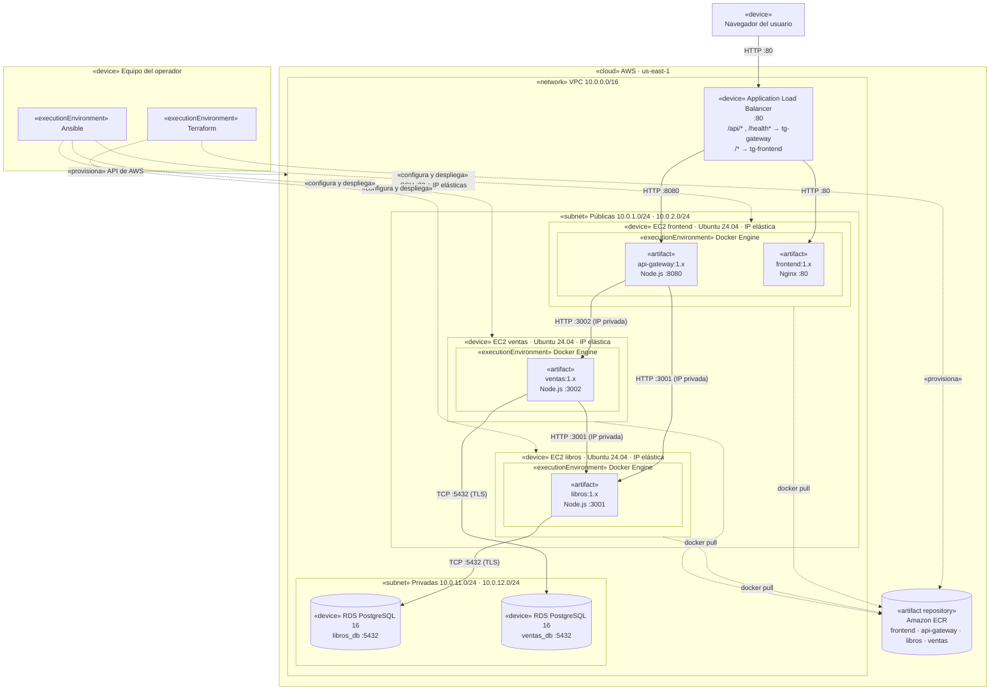

# 03 · Arquitectura de despliegue

Este documento describe cómo se distribuyen los componentes en AWS y qué parte de la
infraestructura crea **Terraform** y qué parte configura **Ansible**.

## 1. Vista general

| Elemento | Recurso AWS | Creado por |
|----------|-------------|------------|
| Red | VPC `10.0.0.0/16`, 2 subredes públicas, 2 subredes privadas, Internet Gateway, tablas de rutas | Terraform |
| Cómputo | 3 instancias EC2 Ubuntu 24.04 `t3.micro`: `frontend`, `libros`, `ventas` | Terraform |
| IP estáticas | 3 IP elásticas, una por instancia | Terraform |
| Balanceo | Application Load Balancer público, 2 *target groups* y reglas por ruta | Terraform |
| Persistencia | 2 instancias RDS PostgreSQL 16 `db.t3.micro` en subredes privadas | Terraform |
| Imágenes | 4 repositorios ECR: `frontend`, `api-gateway`, `libros`, `ventas` | Terraform |
| Permisos | Rol IAM con lectura de ECR asociado a las instancias | Terraform |
| Sistema operativo | Paquetes base, zona horaria, firewall UFW, usuario de despliegue | Ansible |
| Runtime | Docker Engine y plugin Compose desde el repositorio oficial de Docker | Ansible |
| Contenedores | Descarga de imágenes desde ECR y ejecución con red, variables y política de reinicio | Ansible |

## 2. Diagrama UML de despliegue

La fuente UML estricta (nodos, entornos de ejecución y artefactos con estereotipos) está en
[`docs/diagramas/despliegue.puml`](../diagramas/despliegue.puml). La siguiente versión en
Mermaid se renderiza directamente en GitHub.

### 2.1 Elementos del diagrama

| Elemento UML | Estereotipo | Descripción |
|--------------|-------------|-------------|
| Navegador del usuario | `«device»` | Cliente o administrador que accede por HTTP al DNS del ALB. |
| Application Load Balancer | `«device»` | Único punto de entrada público. Distribuye por ruta a dos *target groups*. |
| EC2 frontend / libros / ventas | `«device»` | Máquinas virtuales con IP elástica. |
| Docker Engine | `«executionEnvironment»` | Entorno donde corren los contenedores, instalado por Ansible. |
| `frontend`, `api-gateway`, `libros`, `ventas` | `«artifact»` | Imágenes Docker versionadas, descargadas de ECR. |
| RDS `libros_db` / `ventas_db` | `«device»` | Bases gestionadas, sin acceso público. |
| Amazon ECR | `«artifact repository»` | Registro privado de imágenes. |
| Terraform / Ansible | `«executionEnvironment»` | Herramientas que corren en el equipo del operador. |
