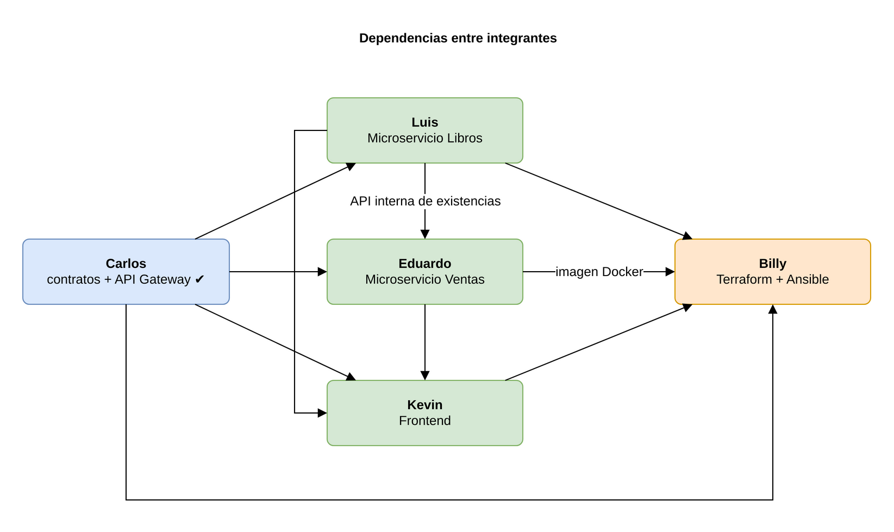

# Tareas por integrante — Práctica 2, Grupo 4

Este documento le dice a cada integrante qué le toca construir, en qué ramas y cómo se
conecta con lo que ya está en `develop`. Léanlo completo una vez y después vayan directo a
su sección.

## 0. Qué ya está hecho (en `develop`)

| Entregable | Ubicación |
|------------|-----------|
| Requerimientos, casos de uso, drivers y matrices de trazabilidad | [`docs/arquitectura/01-requerimientos.md`](../arquitectura/01-requerimientos.md) |
| Arquitectura lógica: capas, componentes, modelo de datos, flujo de venta | [`docs/arquitectura/02-arquitectura.md`](../arquitectura/02-arquitectura.md) |
| Arquitectura de despliegue y diagrama UML | [`docs/arquitectura/03-despliegue.md`](../arquitectura/03-despliegue.md) |
| Contratos de API (**léanlos antes de programar**) | [`docs/arquitectura/04-contratos-api.md`](../arquitectura/04-contratos-api.md), [`docs/api/`](../api/) |
| Decisiones de arquitectura | [`docs/arquitectura/adr/`](../arquitectura/adr/) |
| API Gateway funcionando y probada | [`api-gateway/`](../../api-gateway/) |
| Entorno local con todos los componentes | [`docker-compose.yml`](../../docker-compose.yml) |
| Integración continua de ejemplo | [`.github/workflows/api-gateway.yml`](../../.github/workflows/api-gateway.yml) |

El gateway ya enruta `/api/v1/libros*` hacia Libros y `/api/v1/ventas*` hacia Ventas, valida
la llave de administración y **no la reenvía**. Los microservicios **no** implementan
autenticación: confían en que solo el gateway (y Ventas, en el caso de Libros) puede llegar
a ellos por red.

---

## 1. Antes de empezar (todos)

### 1.1 Preparar el repositorio

Carlos debe agregarlos como colaboradores en GitHub (*Settings → Collaborators*). Después:

```bash
git clone https://github.com/CarlosPerez10/AYD2_B_2S2026_P2_G4.git
cd AYD2_B_2S2026_P2_G4
git switch develop

# Autoría con SUS datos (solo en este repositorio)
git config user.name  "Su Nombre Completo"
git config user.email "su-correo@ejemplo.com"
```

Verifiquen con `git config user.name` antes del primer commit. **Cada commit debe salir con su
propio nombre y correo**; el enunciado lo exige.

Requisitos en su equipo: Git, Node.js 22, Docker Desktop. Billy además necesita Terraform ≥ 1.6,
Ansible ≥ 2.15 (en Windows, desde WSL) y AWS CLI v2.

### 1.2 Flujo por cada rama

```bash
git switch develop
git pull
git switch -c feature/libros-base_202307727   # su rama, con su carnet

# ... trabajo con commits pequeños ...
git add <archivos>
git commit -m "feat(libros): agrega endpoint de salud con verificacion de base de datos"

git push -u origin feature/libros-base_202307727
```

Luego abran un **Pull Request hacia `develop`** en GitHub con la plantilla del repositorio y
asignen a Carlos como revisor. Cuando se aprueba, el merge lo hace Carlos.

### 1.3 Reglas de commits

- Formato: `tipo(alcance): descripción en imperativo` (ver [CONTRIBUTING.md](../../CONTRIBUTING.md)).
- **Un commit por cambio lógico**: una ruta, un validador, una migración, una prueba, un módulo de Terraform. No junten todo en un commit final.
- El merge del PR **no cuenta** como commit válido; cuentan los commits de su rama.
- No suban `.env`, `terraform.tfvars`, llaves `.pem` ni contraseñas (ya están en `.gitignore`).
- Antes del PR: `git pull origin develop` en su rama y verifiquen que sus pruebas pasan.

### 1.4 Reglas técnicas comunes (Libros y Ventas)

Para que todo encaje con el gateway y entre sí:

| Tema | Regla |
|------|-------|
| Lenguaje | Node.js 22, Express 5, módulos ES (`"type": "module"`), igual que `api-gateway/`. |
| Base de datos | Paquete `pg` con SQL parametrizado (`$1, $2…`). Nada de concatenar strings en SQL. |
| Capas | `routes → controllers → validators/services → repositories` (ver 02-arquitectura §3). |
| Respuestas | Éxito: `{ "data": ... }`; listados: `{ "data": [...], "meta": {...} }`. |
| Errores | `{ "error": { "codigo", "mensaje", "detalles?", "requestId" } }` con los códigos de 04-contratos-api §4. |
| Trazabilidad | Lean `X-Request-Id` del encabezado (si no viene, generen uno), devuélvanlo en la respuesta e inclúyanlo en cada log. |
| Logs | JSON en una línea. Pueden copiar `api-gateway/src/utils/logger.js`. |
| Salud | `GET /health` → `200 {estado:"ok", servicio, version, baseDeDatos:"ok", tiempoActivo}` o `503` con `baseDeDatos:"error"` si `SELECT 1` falla. El gateway ya lo consume. |
| Configuración | Solo variables de entorno, validadas al arrancar (ver `api-gateway/src/config/index.js`). |
| Cuerpo | `express.json({ limit: '100kb' })`; JSON inválido → `400 VALIDACION`; muy grande → `413`. |
| Apagado | En `SIGTERM`: cerrar el servidor y luego `pool.end()`. |
| Docker | Igual que `api-gateway/Dockerfile`: `node:22-alpine`, multi-etapa, `USER node`, `HEALTHCHECK` a `/health`. |
| Pruebas | `node:test` + `supertest`. Repositorios simulados para probar servicios sin BD. |
| CI | Copien `.github/workflows/api-gateway.yml` y cambien la carpeta. |
| SSL a RDS | Si `DB_SSL=true`, conecten con `ssl: { rejectUnauthorized: true, ca: <bundle de RDS> }`. Descarguen `global-bundle.pem` de AWS dentro de la imagen. En local `DB_SSL=false`. |

Variables que el `docker-compose.yml` y Ansible les van a pasar:

| Variable | Libros | Ventas |
|----------|--------|--------|
| `PORT` | `3001` | `3002` |
| `DB_HOST`, `DB_PORT`, `DB_NAME`, `DB_USER`, `DB_PASSWORD`, `DB_SSL` | ● | ● |
| `LOG_LEVEL`, `NODE_ENV` | ● | ● |
| `LIBROS_SERVICE_URL` | | ● (`http://libros:3001` en local) |
| `APP_VERSION` | ● | ● |

---

## 2. Luis Fernando González — 202307727 · Microservicio de Libros

**Contrato:** [`docs/api/libros.openapi.yaml`](../api/libros.openapi.yaml) · **Carpeta:** `services/libros/`

### Ramas, en este orden

#### 2.1 `feature/libros-base_202307727`

- `package.json` (scripts `start`, `dev`, `test`), `src/app.js`, `src/server.js`.
- `src/config/index.js` con las variables de la tabla 1.4.
- Middlewares: `requestId`, registro de peticiones, `manejoErrores`, `rutaNoEncontrada`.
- `GET /health` (por ahora sin BD).
- `.env.example`.

#### 2.2 `feature/libros-persistencia_202307727`

- `src/db/pool.js` (pool de `pg`, SSL según `DB_SSL`).
- `src/db/migraciones/001_crear_libro.sql`, ejecutadas al arrancar y **idempotentes** (`IF NOT EXISTS`):

```sql
CREATE EXTENSION IF NOT EXISTS unaccent;
CREATE EXTENSION IF NOT EXISTS pg_trgm;

CREATE TABLE IF NOT EXISTS libro (
  id             SERIAL PRIMARY KEY,
  isbn           VARCHAR(13) UNIQUE,
  titulo         VARCHAR(200) NOT NULL,
  autor          VARCHAR(150) NOT NULL,
  precio         NUMERIC(10,2) NOT NULL CHECK (precio > 0),
  existencias    INTEGER NOT NULL CHECK (existencias >= 0),
  creado_en      TIMESTAMPTZ NOT NULL DEFAULT now(),
  actualizado_en TIMESTAMPTZ NOT NULL DEFAULT now()
);
```

- Índices de búsqueda (02-arquitectura §5.1). Ojo: `unaccent()` no es `IMMUTABLE`; creen una función envoltorio `IMMUTABLE` (`f_unaccent`) para poder indexarla.
- `src/db/semilla.sql` con **al menos 25 libros** reales (autores latinoamericanos, clásicos, etc.), insertados solo si la tabla está vacía.
- `/health` ahora hace `SELECT 1`.
- Los `NUMERIC` llegan como texto desde `pg`: conviértanlos a número en el repositorio.

#### 2.3 `feature/libros-crud_202307727`

- `GET /api/v1/libros/:id`, `POST /api/v1/libros`, `PUT /api/v1/libros/:id`, `DELETE /api/v1/libros/:id`.
- Validador: título y autor obligatorios (con *trim*), precio > 0 con máximo 2 decimales, existencias entero ≥ 0, ISBN opcional de 13 dígitos, sin campos extra.
- ISBN duplicado (error `23505` de PostgreSQL) → `409 CONFLICTO`.
- Mapeo `snake_case` (BD) → `camelCase` (API).

#### 2.4 `feature/libros-busqueda_202307727`

- `GET /api/v1/libros` con `q`, `autor`, `precioMin`, `precioMax`, `disponibles`, `orden`, `pagina`, `limite`.
- `q` busca en título **o** autor, sin distinguir mayúsculas ni tildes: `f_unaccent(lower(titulo)) LIKE f_unaccent(lower($1))` con `%texto%`.
- El `orden` sale de una **lista blanca** (`titulo`, `-titulo`, `autor`, `-autor`, `precio`, `-precio`); nunca se interpola el texto del usuario en `ORDER BY`.
- `meta`: `pagina`, `limite`, `total`, `totalPaginas` (usen `COUNT(*) OVER()` o una segunda consulta).
- `GET /api/v1/libros/autores` (lista `DISTINCT` ordenada). **Declárenla antes de `/:id`.**
- `precioMin > precioMax` → `400`.

#### 2.5 `feature/libros-existencias_202307727`

API interna que usa Ventas (no pasa por el gateway):

- `POST /internal/v1/libros/:id/descontar` `{ cantidad }`:

```sql
UPDATE libro
   SET existencias = existencias - $2, actualizado_en = now()
 WHERE id = $1 AND existencias >= $2
RETURNING *;
```

  Si no devuelve fila, distingan si el libro no existe (`404`) o no alcanzan (`409 EXISTENCIAS_INSUFICIENTES` con `detalles: { disponibles, solicitadas }`).
- `POST /internal/v1/libros/:id/reponer` `{ cantidad }` (suma).
- Una sola sentencia: así dos ventas simultáneas no dejan existencias negativas (RNF-05).

#### 2.6 `build/libros-docker_202307727`

- `Dockerfile`, `.dockerignore`, puerto `3001`.
- Prueben con `docker compose up --build libros` desde la raíz.

#### 2.7 `tests/libros_202307727`

- Validadores (casos válidos e inválidos), servicio con repositorio simulado, rutas con Supertest.
- Workflow `.github/workflows/libros.yml`.
- Actualicen `services/libros/README.md` (variables, cómo correr, cómo probar).

**Listo cuando:** cumple el OpenAPI, `docker compose up` lo levanta con datos semilla, la búsqueda
encuentra "garcia" en "García Márquez" y sus pruebas pasan en CI.

---

## 3. Eduardo Misael López Ávila — 202100147 · Microservicio de Ventas

**Contrato:** [`docs/api/ventas.openapi.yaml`](../api/ventas.openapi.yaml) · **Carpeta:** `services/ventas/`
**Lean antes:** 02-arquitectura §6 y [ADR-004](../arquitectura/adr/ADR-004-comunicacion-sincrona-con-compensacion.md).

### Ramas, en este orden

#### 3.1 `feature/ventas-base_202100147`

Igual que la 2.1 de Libros, puerto `3002`, más la variable `LIBROS_SERVICE_URL`.

#### 3.2 `feature/ventas-persistencia_202100147`

```sql
CREATE TABLE IF NOT EXISTS venta (
  id              SERIAL PRIMARY KEY,
  libro_id        INTEGER NOT NULL,
  titulo          VARCHAR(200) NOT NULL,
  autor           VARCHAR(150) NOT NULL,
  cantidad        INTEGER NOT NULL CHECK (cantidad > 0),
  precio_unitario NUMERIC(10,2) NOT NULL,
  total           NUMERIC(12,2) NOT NULL,
  fecha           TIMESTAMPTZ NOT NULL DEFAULT now()
);
CREATE INDEX IF NOT EXISTS idx_venta_libro_id ON venta (libro_id);
CREATE INDEX IF NOT EXISTS idx_venta_fecha ON venta (fecha);
```

- **No** hay llave foránea a Libros (otra base de datos).
- Semilla opcional de ventas de ejemplo, con `libro_id` que existan en la semilla de Luis (coordínenlo), para que el ranking tenga datos desde el inicio.

#### 3.3 `feature/ventas-cliente-libros_202100147`

`src/clients/librosClient.js`:

- `obtenerLibro(id)` → `GET {LIBROS_SERVICE_URL}/api/v1/libros/:id`
- `descontar(id, cantidad)` → `POST /internal/v1/libros/:id/descontar`
- `reponer(id, cantidad)` → `POST /internal/v1/libros/:id/reponer`
- `fetch` nativo con `AbortSignal.timeout(3000)` y reenvío del `X-Request-Id`.
- Mapeo: `404` → `ApiError 404`; `409` → `ApiError 409 EXISTENCIAS_INSUFICIENTES` (conserven `detalles`); sin conexión o tiempo agotado → `ApiError 503 SERVICIO_NO_DISPONIBLE`.

#### 3.4 `feature/ventas-registro_202100147`

`POST /api/v1/ventas` `{ libroId, cantidad }` con la saga:

1. `obtenerLibro` (precio, título y autor vigentes).
2. `descontar`.
3. `INSERT` con `total = cantidad × precio_unitario` (calculen con centavos enteros para no arrastrar errores de punto flotante).
4. Si el `INSERT` falla: `reponer` y responder `500`. Si `reponer` también falla, regístrenlo en el log como **error crítico** con todos los datos para corregirlo a mano.

Además:

- `GET /api/v1/ventas` (historial paginado, filtros `desde`, `hasta`, `libroId`, más recientes primero).
- `GET /api/v1/ventas/:id`.

#### 3.5 `feature/ventas-ranking_202100147`

- `GET /api/v1/ventas/ranking?limite=10&desde=&hasta=` con la consulta de 02-arquitectura §5.3.
- **Declárenla antes de `/:id`.**
- Agreguen `posicion` (1, 2, 3…) y `meta.generadoEn`.
- `desde`/`hasta` deben ser fechas ISO válidas y `desde < hasta`; `limite` entre 1 y 50.
- El ranking **no** llama a Libros: debe funcionar aunque Libros esté caído.

#### 3.6 `build/ventas-docker_202100147`

Dockerfile, `.dockerignore` y prueba con `docker compose up --build`.

#### 3.7 `tests/ventas_202100147`

- La saga con el cliente de Libros simulado: éxito, libro inexistente, sin existencias, Libros caído y falla al guardar (verifiquen que se llamó a `reponer`).
- El ranking: orden, desempates y filtro de fechas.
- Workflow `.github/workflows/ventas.yml`.

#### 3.8 `tests/prueba_carga_202100147`

- `tests/carga/` en la raíz con un script de [k6](https://k6.io) o `autocannon` contra el gateway: búsqueda de libros y ranking con 50 usuarios virtuales durante 1 minuto.
- Documenten el resultado (p95, errores) en `tests/carga/README.md`. Es la evidencia de RNF-02.

**Listo cuando:** una venta descuenta existencias en Libros, una venta sin existencias da `409`
sin guardar nada, el ranking refleja las ventas y las pruebas pasan en CI.

---

## 4. Kevin Mark Hernández Chicol — 202001053 · Frontend y manual de usuario

**Carpeta:** `frontend/` · **Consume:** solo la API Gateway.

### Reglas de integración (importantes)

- Todas las llamadas usan **rutas relativas** `/api/v1/...`. Nunca escriban `localhost:8080` en el código.
- En local, Nginx reenvía `/api/` al contenedor `api-gateway`; en AWS el ALB manda `/api/*` directo al gateway. Así el mismo build sirve en ambos lados.
- La llave de administración la escribe el usuario en la vista de administración y se guarda en `sessionStorage`; se envía como encabezado `X-Api-Key` solo en operaciones de administración.
- Muestren el `requestId` en los mensajes de error: ayuda a buscar el problema en los logs.

### Ramas, en este orden

#### 4.1 `feature/frontend-base_202001053`

- Vite + React 18 + React Router.
- Layout con encabezado y navegación: **Catálogo**, **Más vendidos**, **Administración**.
- `src/api/cliente.js`: envoltorio de `fetch` que entiende `{ data, meta }` y `{ error }`.
- Componentes comunes: `Cargando`, `MensajeError`, `EstadoVacio`, `Paginacion`.

#### 4.2 `feature/frontend-catalogo_202001053`

Tabla o tarjetas con título, autor, precio (`Q 189.50`) y existencias. Marquen "Agotado"
cuando sean 0. Paginación con `pagina`/`limite`.

#### 4.3 `feature/frontend-busqueda_202001053`

- Buscador con espera de 300 ms (*debounce*) → `?q=`.
- Filtros: autor (lista desde `GET /api/v1/libros/autores`), precio mínimo y máximo, "solo disponibles", orden.
- Los filtros viven en la URL (`useSearchParams`) para poder compartir un enlace con la búsqueda.
- Botón "Limpiar filtros" y mensaje "No se encontraron libros para «…»".

#### 4.4 `feature/frontend-detalle_202001053`

`/libros/:id` con todos los datos y el botón para volver conservando la búsqueda.

#### 4.5 `feature/frontend-ranking_202001053`

- `/mas-vendidos`: top 10 con posición, título, autor, unidades y monto.
- Filtro por rango de fechas y cantidad (5, 10, 20).
- Un gráfico de barras simple (CSS o una librería ligera) es un buen extra.

#### 4.6 `feature/frontend-admin_202001053`

- Campo para la llave de administración (con botón "Cerrar sesión" que la borra).
- Formulario de crear y editar libro con validación en el cliente (mismas reglas que el servidor) y mensajes de error por campo usando `error.detalles`.
- Eliminar con confirmación.
- Registrar venta: elegir libro, cantidad y mostrar el `409` de existencias de forma clara.
- Historial de ventas paginado.

#### 4.7 `build/frontend-docker_202001053`

`frontend/Dockerfile` multi-etapa (`node:22-alpine` para construir → `nginx:1.27-alpine` para servir) y `frontend/nginx.conf`:

```nginx
server {
  listen 80;
  root /usr/share/nginx/html;

  gzip on;
  gzip_types text/css application/javascript application/json image/svg+xml;

  location /api/ {
    proxy_pass http://api-gateway:8080;
    proxy_set_header Host $host;
    proxy_set_header X-Forwarded-For $proxy_add_x_forwarded_for;
    proxy_set_header X-Request-Id $request_id;
  }

  location /assets/ {
    expires 1y;
    add_header Cache-Control "public, immutable";
  }

  location / {
    try_files $uri /index.html;
  }
}
```

Prueben con `docker compose up --build` desde la raíz y entren a `http://localhost:8081`.

#### 4.8 `docs/manual-usuario_202001053`

`docs/manuales/manual-usuario.md`, con capturas en `docs/manuales/img/`:

1. Introducción y requisitos (navegador, URL del sistema).
2. Navegación general (encabezado y menú).
3. Consultar el catálogo y cambiar de página.
4. Buscar por título o autor y usar los filtros.
5. Ver el detalle de un libro.
6. Consultar los más vendidos y filtrar por fechas.
7. Administración: ingresar la llave, crear, editar y eliminar libros, registrar ventas y ver el historial.
8. Mensajes de error comunes y qué hacer.

**Listo cuando:** se puede usar todo el sistema desde el navegador, funciona en el celular,
cada vista tiene estados de carga, vacío y error, y el manual tiene capturas reales.

---

## 5. Billy James Asael Chamale Sánchez — 201907502 · Infraestructura y despliegue

**Carpeta:** `infra/` · **Lean antes:** [03-despliegue.md](../arquitectura/03-despliegue.md) y [ADR-006](../arquitectura/adr/ADR-006-ec2-con-ip-elastica-y-alb.md).
La red, los grupos de seguridad y los nombres ya están definidos en 03-despliegue §3; respétenlos
para que el diagrama UML coincida con lo desplegado.

> **Si usan AWS Academy (Learner Lab):** no se pueden crear roles IAM. En lugar del rol propio,
> usen el perfil existente `LabInstanceProfile` en las instancias (déjenlo como variable
> `perfil_instancia`) y recuerden que las credenciales del laboratorio caducan cada sesión.

### Ramas, en este orden

#### 5.1 `infra/terraform-red_201907502`

- `infra/terraform/main.tf` (proveedor `hashicorp/aws ~> 5.0`, región por variable, `default_tags` con `Proyecto = "libreria-ayd"`).
- `modules/red`: VPC `10.0.0.0/16`, subredes públicas `10.0.1.0/24` y `10.0.2.0/24`, privadas `10.0.11.0/24` y `10.0.12.0/24` en dos zonas, Internet Gateway y tablas de rutas.

#### 5.2 `infra/terraform-seguridad_201907502`

`modules/seguridad`: los 6 grupos de la tabla 03-despliegue §3.2, con reglas que referencian
grupos (no rangos abiertos) y SSH solo desde `var.ip_operador`.

#### 5.3 `infra/terraform-computo_201907502`

- `modules/computo`: AMI Ubuntu 24.04 con `data "aws_ami"` (owner `099720109477`), 3 instancias `t3.micro`, `aws_key_pair`, rol IAM con la política `AmazonEC2ContainerRegistryReadOnly` y su perfil de instancia.
- **3 `aws_eip`** asociadas a las instancias (requisito de IP estáticas).

#### 5.4 `infra/terraform-balanceador_201907502`

- `modules/balanceador`: ALB público en las dos subredes públicas.
- `tg-frontend` (puerto 80, *health check* `/`) y `tg-gateway` (puerto 8080, *health check* `/health`).
- Listener `:80` con acción por defecto hacia `tg-frontend` y una regla con `path_pattern` `["/api/*", "/health*"]` hacia `tg-gateway`.

#### 5.5 `infra/terraform-base-datos_201907502`

- `modules/base_datos`: `aws_db_subnet_group` con las subredes privadas y **2** `aws_db_instance` PostgreSQL 16, `db.t3.micro`, `publicly_accessible = false`, `storage_encrypted = true`, `max_allocated_storage` para autoescalar disco, `backup_retention_period` ≥ 1.
- Contraseñas como variables `sensitive`.

#### 5.6 `infra/terraform-registro_201907502`

- `modules/registro`: 4 `aws_ecr_repository` (`frontend`, `api-gateway`, `libros`, `ventas`) con `scan_on_push` y una política de ciclo de vida (conservar las últimas 10 imágenes).
- `outputs.tf`: IP elásticas, IP privadas, DNS del ALB, endpoints de RDS y URLs de ECR.
- `terraform.tfvars.example` (sin valores reales).
- `terraform fmt -recursive` y `terraform validate` sin errores.

#### 5.7 `infra/ansible-base_201907502`

- `ansible.cfg`, `inventory/hosts.ini.example` con los grupos `frontend`, `libros` y `ventas`.
- `scripts/generar-inventario.sh`: arma `hosts.ini` y las variables a partir de `terraform output -json`.
- `roles/comun`: `apt` actualizado, zona horaria `America/Guatemala`, UFW con las reglas de cada VM, usuario de despliegue.
- `roles/docker`: Docker Engine y plugin de Compose desde el **repositorio oficial de Docker** (no el paquete `docker.io` de Ubuntu), usuario en el grupo `docker`.
- `roles/ecr_login`: paquete `amazon-ecr-credential-helper` y `~/.docker/config.json` con `credsStore: ecr-login` (usa el rol de la instancia, sin llaves en disco).
- `group_vars/all/vault.yml` cifrado con `ansible-vault` (`ADMIN_API_KEY` y contraseñas de BD).

#### 5.8 `infra/ansible-despliegue_201907502`

Con `community.docker.docker_container`:

| VM | Contenedores | Puerto publicado | Variables clave |
|----|--------------|------------------|-----------------|
| libros | `libros` | 3001 | `DB_HOST` = endpoint de RDS libros, `DB_SSL=true` |
| ventas | `ventas` | 3002 | `DB_HOST` = endpoint de RDS ventas, `DB_SSL=true`, `LIBROS_SERVICE_URL=http://<IP privada libros>:3001` |
| frontend | `api-gateway`, `frontend` | 8080, 80 | `LIBROS_SERVICE_URL`, `VENTAS_SERVICE_URL` con IP privadas, `ADMIN_API_KEY` desde Vault, `TRUST_PROXY_HOPS=1` |

- En la VM de frontend, ambos contenedores en una red de Docker propia y con **nombre exacto `api-gateway`**, porque `nginx.conf` de Kevin lo usa.
- `restart_policy: unless-stopped`, *healthcheck* y espera con el módulo `uri` hasta que `/health` responda `200`.
- `site.yml` que aplique `comun`, `docker` y `ecr_login` a todas las VMs y luego despliegue en orden: libros → ventas → frontend.
- La segunda ejecución de `ansible-playbook` no debe reportar cambios (idempotencia).

#### 5.9 `ci/build-push-ecr_201907502`

- `scripts/build-push.sh <version>`: login en ECR, `docker build` de las 4 imágenes, etiquetas `<version>` y `latest`, y `docker push`.
- Opcional: workflow de GitHub Actions que lo ejecute al crear un tag `v*`.

#### 5.10 `docs/guia-despliegue_201907502`

`docs/manuales/guia-despliegue.md`: requisitos, `terraform init/plan/apply`, build y push,
generación del inventario, `ansible-playbook`, verificación por el DNS del ALB, cómo destruir
todo (`terraform destroy`) y costos aproximados.

**Listo cuando:** desde una cuenta vacía, siguiendo solo la guía, la plataforma queda accesible
por el DNS del ALB, y `terraform destroy` deja la cuenta limpia.

---

## 6. Carlos Javier Pérez Pocón — 202206425 · Integración y releases

- Revisar cada PR contra los contratos y los criterios de este documento.
- Integrar en `develop` y probar el sistema completo con `docker compose up --build`.
- Ajustar los documentos de arquitectura si algo cambia durante la implementación.
- Releases (ver [plan-de-trabajo.md §4](plan-de-trabajo.md#4-releases)):
  - **v0.1.0**: gateway + Libros + Ventas funcionando con Compose.
  - **v0.2.0**: + frontend y módulos de Terraform y Ansible validados.
  - **v1.0.0**: desplegado en AWS, manual de usuario y guía de despliegue.
- Coordinar el despliegue final con Billy.

---

## 7. Dependencias entre integrantes



Nadie tiene que esperar a nadie para empezar:

- **Eduardo** puede programar contra un Libros simulado en sus pruebas; el contrato ya está.
- **Kevin** puede maquetar con datos de ejemplo que respeten el formato del OpenAPI y conectarlo cuando Libros y Ventas estén en `develop`.
- **Billy** puede escribir y validar todo Terraform desde ya; Ansible solo necesita las imágenes al final.

Cualquier duda sobre un contrato: issue en GitHub o al grupo, **antes** de cambiarlo.
