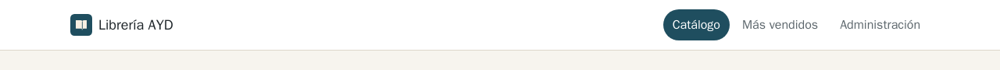
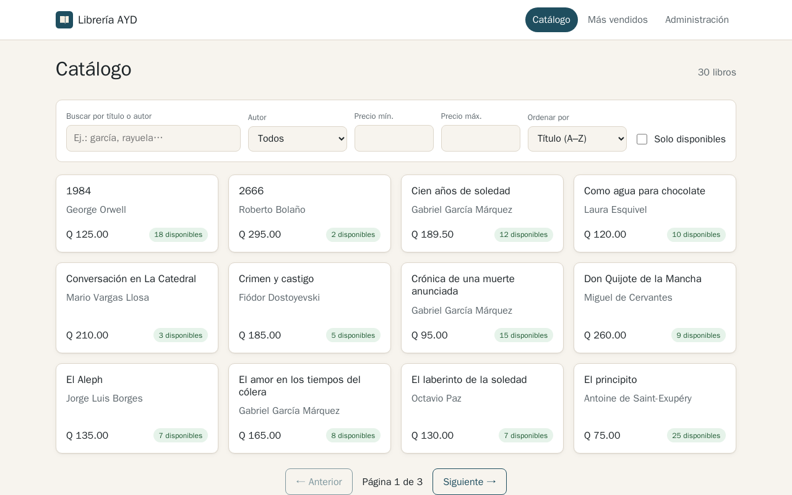
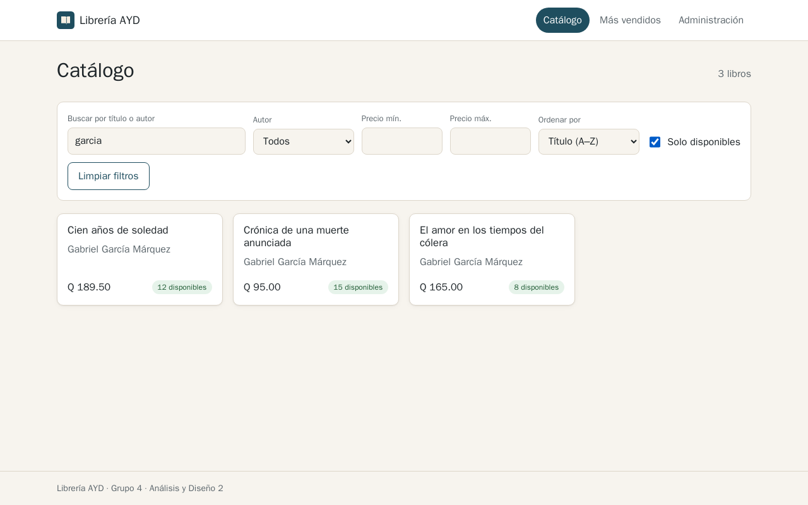
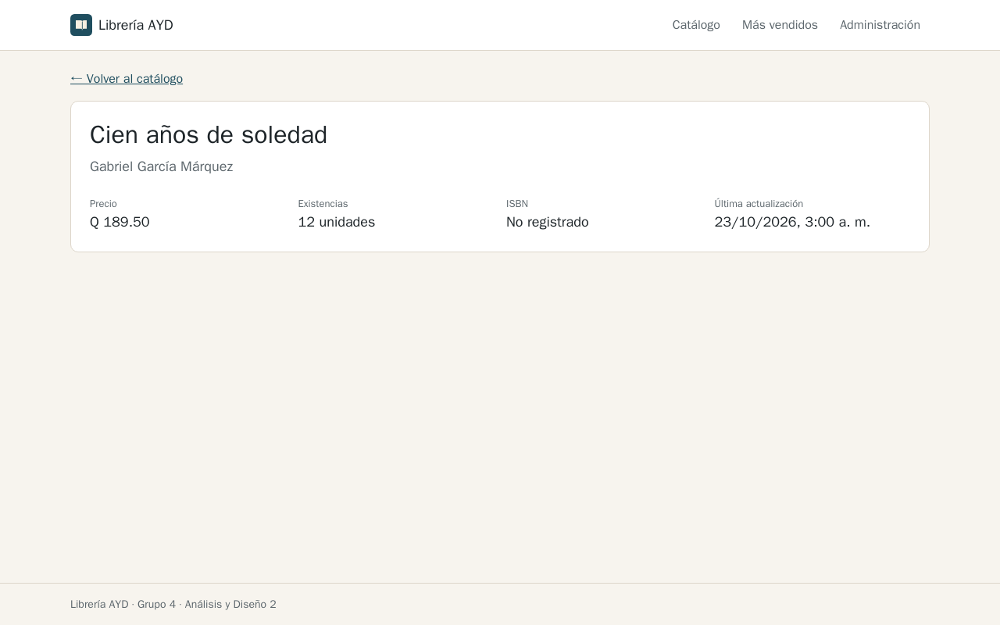
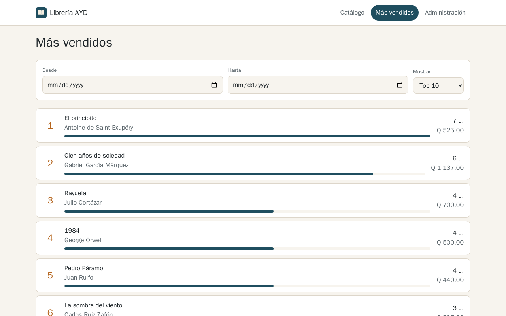
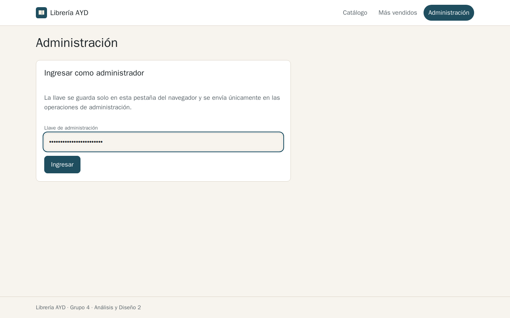
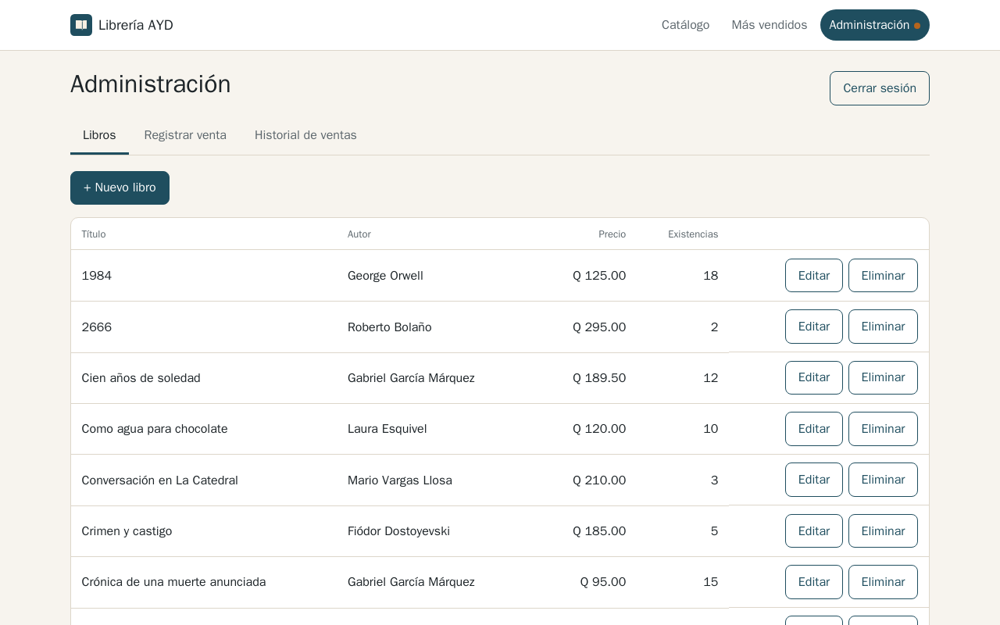
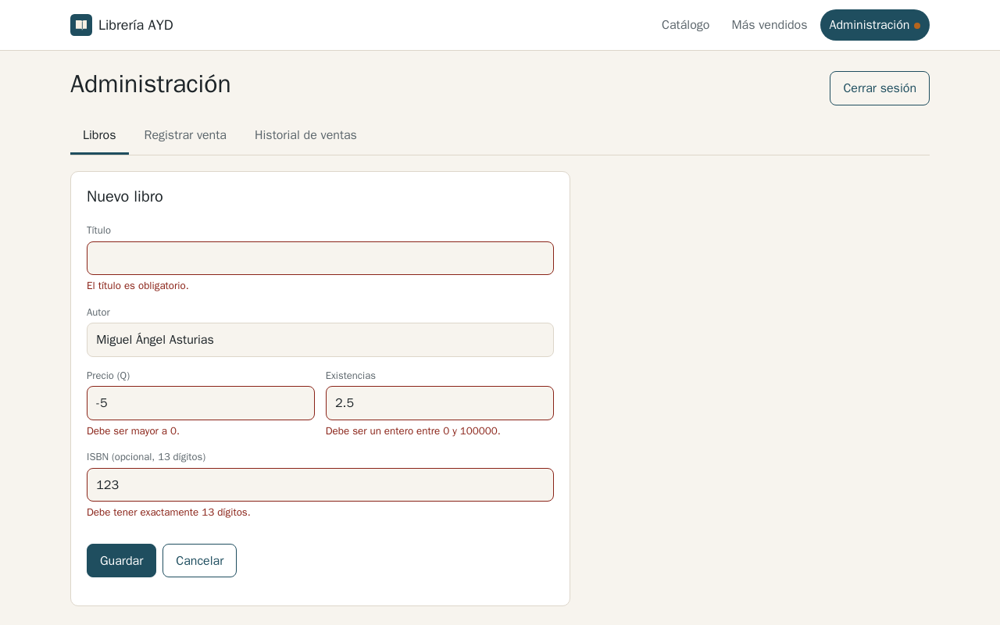
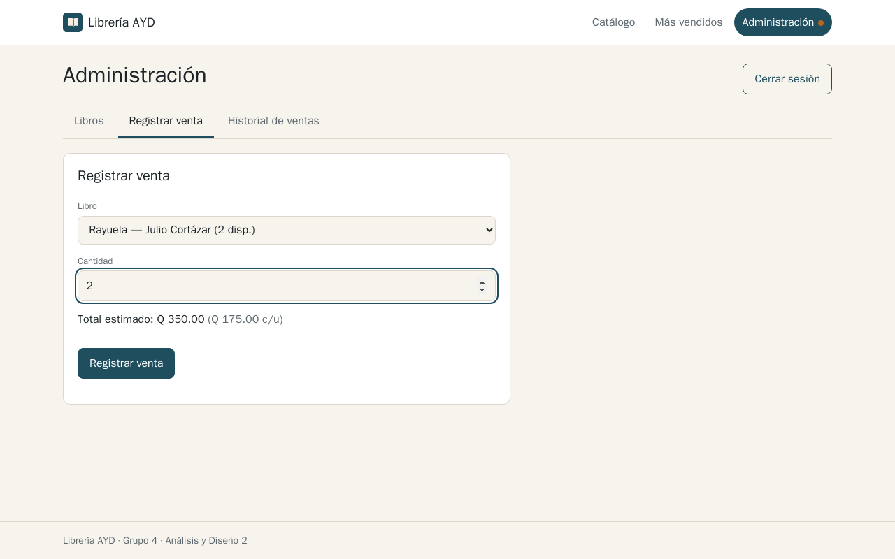
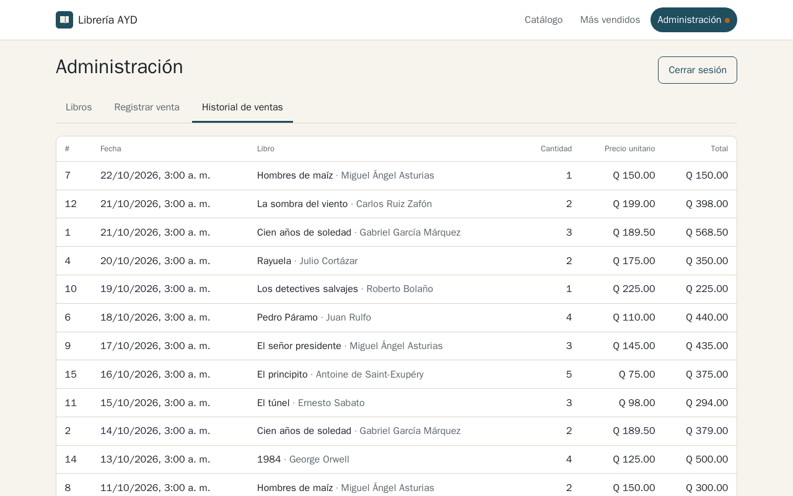

# Manual de usuario — Librería AYD

Responsable: **Kevin Mark Hernández Chicol** (202001053)

> Las capturas se tomaron del sistema en ejecución con los datos semilla (versión 1.0.0).

## 1. Introducción y requisitos

La Librería AYD es una aplicación web para consultar el catálogo de libros, buscar por título
o autor, ver los libros más vendidos y, como administrador, registrar libros y ventas.

| Requisito | Detalle |
|-----------|---------|
| Navegador | Chrome, Edge, Firefox o Safari en versión reciente; funciona en computadora y celular. |
| Dirección | Local: `http://localhost:8081`. En AWS: el DNS del balanceador que entregue el equipo. |
| Administración | Una llave de administración entregada por el equipo. |

## 2. Navegación general

El encabezado está en todas las páginas:

- **Librería AYD** (logotipo): vuelve al catálogo.
- **Catálogo**: listado y búsqueda de libros.
- **Más vendidos**: ranking de ventas.
- **Administración**: gestión de libros y ventas. Un punto naranja indica que hay una sesión
  de administrador activa.

## 3. Consultar el catálogo

Cada tarjeta muestra el título, el autor, el precio en quetzales (por ejemplo `Q 189.50`) y
las unidades disponibles. Los libros sin existencias se marcan como **Agotado**.

Use **← Anterior** y **Siguiente →** al pie de la lista para cambiar de página.

## 4. Buscar y filtrar

1. Escriba en **Buscar por título o autor**. La búsqueda se hace sola al dejar de escribir y
   no distingue mayúsculas ni tildes: `garcia` encuentra "Gabriel García Márquez".
2. Combine los filtros que necesite:
   - **Autor**: lista de autores del catálogo.
   - **Precio mín.** y **Precio máx.**: rango en quetzales.
   - **Ordenar por**: título, autor o precio, en ambos sentidos.
   - **Solo disponibles**: oculta los libros agotados.
3. **Limpiar filtros** regresa al catálogo completo.

La dirección del navegador guarda la búsqueda: puede copiarla y compartirla.
Si no hay resultados verá el mensaje *No se encontraron libros para «…»*.

## 5. Ver el detalle de un libro

Haga clic en el título de una tarjeta. Se muestran precio, existencias, ISBN y la fecha de
la última actualización. **← Volver al catálogo** regresa a la misma búsqueda y página.

## 6. Consultar los más vendidos

La página muestra la posición, el título, el autor, las unidades vendidas y el monto total,
con una barra proporcional a las unidades.

- **Desde** y **Hasta** limitan el período (ambos días incluidos).
- **Mostrar** elige el Top 5, 10 o 20.
- **Quitar fechas** vuelve al ranking histórico completo.

## 7. Administración

### 7.1 Ingresar la llave

En **Administración**, escriba la llave y presione **Ingresar**. La llave se guarda solo en
la pestaña actual del navegador: al cerrarla o al presionar **Cerrar sesión** se borra.
Si la llave es incorrecta, al intentar una operación verá *La llave de administración no es
válida* y el botón **Ingresar otra llave**.

### 7.2 Crear, editar y eliminar libros

- **+ Nuevo libro** abre el formulario. Título y autor son obligatorios; el precio debe ser
  mayor a 0 con hasta 2 decimales; las existencias, un entero desde 0; el ISBN es opcional
  y debe tener 13 dígitos.
- **Editar** abre el mismo formulario con los datos actuales.
- **Eliminar** pide confirmación (**Sí, eliminar** / **No**).

Los errores aparecen debajo de cada campo. Un ISBN repetido muestra un mensaje de conflicto.

### 7.3 Registrar una venta

1. Elija el libro (los agotados aparecen deshabilitados).
2. Indique la cantidad; se muestra el total estimado.
3. Presione **Registrar venta**.

Si no hay unidades suficientes verá **No hay existencias suficientes**, con las unidades
disponibles y las solicitadas. La venta no se registra y las existencias no cambian.

### 7.4 Historial de ventas

Lista las ventas de la más reciente a la más antigua, con fecha, libro, cantidad, precio
unitario y total, paginadas de 20 en 20.

## 8. Mensajes de error comunes

| Mensaje | Qué significa | Qué hacer |
|---------|---------------|-----------|
| *No se pudo conectar con el servidor* | No hay red o el sistema está detenido. | Revise su conexión y presione **Reintentar**. |
| *El servicio de libros/ventas no está disponible* | Un microservicio está caído o reiniciándose. | Espere unos segundos y reintente. |
| *La llave de administración no es válida* | La llave es incorrecta. | **Ingresar otra llave**. |
| *No hay existencias suficientes* | La cantidad supera las unidades disponibles. | Reduzca la cantidad. |
| *Se superó el límite de peticiones* | Demasiadas solicitudes en poco tiempo. | Espere un minuto. |
| *Ya existe un libro con el ISBN …* | El ISBN pertenece a otro libro. | Corrija el ISBN o déjelo vacío. |

Si un error persiste, entregue al equipo el **código de seguimiento** que aparece bajo el
mensaje: permite encontrar la petición exacta en los registros del sistema.
